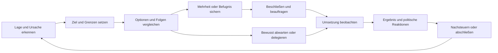
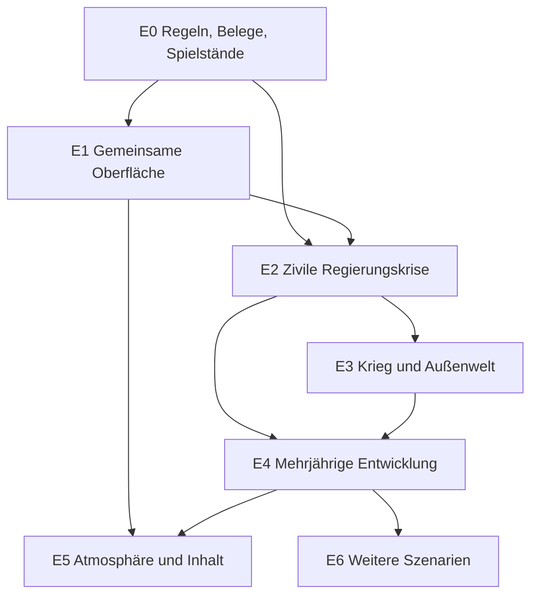

# Staatsräson – Gesamtplan für ein zusammenhängendes Regierungsspiel

**Stand: 2. November 2026 · Arbeitsfassung auf Grundlage der bisherigen Nutzerentscheidungen und des lokalen Projekts.**

Dieser Plan führt die bisherigen Wünsche zu einem gemeinsamen Zielbild, einer Bestandsaufnahme und überprüfbaren Arbeitspaketen zusammen. Er ersetzt keine vorhandenen Funktionen durch bloße Konzeptbeschreibungen. Die neuen Versorgungs-, Haushalts-, Minister- und Fraktionssysteme sind Ausgangspunkt der weiteren Arbeit.

Die jüngsten Handlungswege bei Fraktionsforderungen wurden vor Erstellung dieses Plans implementiert: Maßnahmen, kleinere Eingriffe, Nachträge und politische Pakete sind mit Kosten, Mehrheiten, Zusagen und Koalitionsrisiken ausführbar. 124 gezielte Tests sowie TypeScript und Produktionsbuild sind erfolgreich. Der Nachweis steht im [Projektbericht](VERSORGUNG_PARLAMENT_2026-10-30.md) und in der [Prüfdatei](../reports/Ressort-Forderungswege-Pruefung-2026-11-02.json).

**Das Spiel ist damit nicht fertig.** Eine erfolgreich gebaute Funktion, ein bestandener Test und ein gutes Spielerlebnis sind unterschiedliche Nachweise. Die neueren Oberflächen wurden wegen der unveränderten Zugriffssperre nicht im Browser visuell bestätigt. Dieser Plan behauptet weder eine abgeschlossene Gesamtprüfung noch bereits bewiesene Langzeitbalance.

**Umsetzung begonnen:** Der Regierungsschreibtisch ist am 2. November in „Entscheiden“, „In Arbeit“ und „Rückblick“ gegliedert worden. Drei priorisierte Lagekarten, gezielte Detailauswahl, laufende Regierungsverfahren und der gespeicherte Monatsbericht sind verbunden. 177 unterschiedliche gezielte Tests sowie Produktionsbuild bestanden. U01/U02 sind lokal begonnen beziehungsweise im Schreibtisch umgesetzt; U05 und Q02 bleiben bis zur tatsächlichen Bedien- und Sichtprüfung offen. Details: [Projektbericht](VERSORGUNG_PARLAMENT_2026-10-30.md#gesamtplan-begonnen-regierungsschreibtisch-als-klarer-arbeitsplatz-2-november).

**U03 weiter umgesetzt:** Versorgungspakete und Kurswechsel verwenden jetzt dieselbe gegliederte Entscheidungskarte. Sofortkosten, bedingtes Budget, Zuständigkeit beziehungsweise Mehrheit, Termin und politische Folgen stehen vor der verbindlichen Handlung. Neue Anträge sind von bisherigen Beschlüssen getrennt; „In Arbeit“ öffnet direkt das gewählte Programm. 168 gezielte Tests, darunter 25 neue, bestanden. Die Übertragung auf Haushalt, Minister und Fraktionsforderungen ist im folgenden Schritt lokal umgesetzt; die visuelle Abnahme bleibt offen. Details: [Projektbericht](VERSORGUNG_PARLAMENT_2026-10-30.md#entscheidungskarten-für-versorgung-und-regierungskurs-2-november).

**Gestaltung der Bereichsakten überarbeitet:** Auf die erneute Kritik an den gleichförmigen Reitern folgt eine Änderung des gemeinsamen Grundlayouts in der Wirtschaft und allen acht weiteren Bereichsakten. Fachliche Zugänge ersetzen die zweistufige Navigation über „Instrumente“; Bereichszeichen, eigene Akzentfarben, größere Überschriften und eine ruhige Kennzahlenleiste schaffen mehr Orientierung. Bilanz, Personen und Vorhaben sind nachgeordnet und fachlich benannt. 52 gezielte Tests, darunter 17 neue, sowie TypeScript und Produktionsbuild bestanden; zwei optionale Langzeittests wurden für diese Gestaltungsänderung ausgelassen. Das ist ein lokaler Umsetzungsschritt von U01/U05, keine visuelle Abnahme oder vollständige Neugestaltung aller Fachinhalte. Details: [Projektbericht](VERSORGUNG_PARLAMENT_2026-10-30.md#eigenständige-bereiche-statt-gleichförmiger-reiter-2-november).

**U03 auf die politischen Kernentscheidungen übertragen:** Haushalt, Haushaltsgegenmaßnahmen, Ministerantworten und Fraktionsforderungen verwenden jetzt eine kompakte Alternativenwahl mit ausführlicher Entscheidungskarte nach Auswahl. Das Haushaltsbuch ersetzt die enge Detailspalte; Ministeranfragen erscheinen als persönliche Schreiben. Die tatsächliche Handlung liefert Preis und Sperre vor dem Klick. Nachtrag trotz laufendem Haushaltsgesetz, Zurücknehmen eines Entwurfs und unbeabsichtigte Behördenänderung beim Öffnen sind korrigiert. Verbleibende Fachübersichten erhalten lesbarere Detailflächen und Fokusführung. 191 unterschiedliche gezielte Tests, davon 25 neue, sowie TypeScript und Produktionsbuild bestanden. U05/Q02 und vollständige Bedien- beziehungsweise Kampagnenabnahme bleiben offen. Details: [Projektbericht](VERSORGUNG_PARLAMENT_2026-10-30.md#haushaltsbuch-und-politische-entscheidungen-als-eigene-arbeitsansichten-2-november).

**Neue Priorität des Nutzers – Haushalts- und Kapitalsystem:** Staatsgeld, politischer Spielraum und Verwaltung sind getrennt. Pauschale politische Überlastaufschläge und laufende PK-Gebühren für drei finanzielle Leistungen entfallen; das Finanzbuch verwendet eine gespeicherte reale und nominale Geldbasis sowie dieselbe Defizitformel wie der Kern. Justiz und Diplomatie erhalten Etats. Entscheidungskarten und Monatsberichte führen nachvollziehbare Geldbeträge. 282 gezielte Tests, davon 29 neue, TypeScript und Build bestanden; die Browserabnahme und langfristige Balance bleiben offen. Details: [Projektbericht](VERSORGUNG_PARLAMENT_2026-10-30.md#staatsgeld-politischer-spielraum-und-verwaltung-getrennt-2-november).

**Drei Finanzlücken behoben:** Haushalt, Devisen und Waren verwenden dieselbe aktuelle BIP-Basis. Justiz- und Diplomatiebehörden nutzen ihre eigenen Etats; Altverbrauch bleibt erhalten. Schuldenbestand, Defizit, Wechselkursbewertung und Zinsdienst folgen einer gemeinsamen Monatsrechnung mit gespeichertem Beleg im Finanzbuch. 242 unterschiedliche gezielte Tests, darunter 28 neue, sowie TypeScript und Produktionsbuild bestanden. Die vollständige wirtschaftliche Kalibrierung und visuelle Abnahme bleiben offen. Die [damalige Nachprüfung](VERSORGUNG_PARLAMENT_2026-10-30.md#kritische-anschlussprüfung-auf-nachfrage-des-nutzers-2-november) bleibt dokumentiert; aktueller Abschluss: [Finanzkorrektur](VERSORGUNG_PARLAMENT_2026-10-30.md#drei-finanzlücken-geschlossen-2-november).

**Mehrjährige Regierungsszenarien durchgeführt:** 22 automatisierte Tageskampagnen in elf Szenarien umfassen 97,78 Spieljahre: aktive Regierung, Unterlassen, Rechtsstaatsaufbau/-abbau, Industrie, Bildungsstau, Rezession, Inflation, Stabilisierung, Krieg und gezielte Werke. Sieben vorab reproduzierte Fehler sind behoben: Überschüsse bleiben als Kasse nutzbar, Finanzierung erzeugt keine negativen Bruttoschulden, jede Front braucht tatsächlichen Nachschub, Bauprognosen berücksichtigen Forschungstempo, Warteschlange und Pause. 406 unterschiedliche gezielte Tests, davon 40 neu, sowie TypeScript und Produktionsbuild bestanden. 17 Kampagnen erreichen fünf Jahre; fünf scheitern politisch. Schwere Inflation, industrielle Kapazitätsengpässe, langfristiges Wachstum und größere Kriegsszenarien bleiben konkrete Balanceaufgaben. Keine Browserabnahme. Der [Langzeitbericht](REGIERUNG_LANGZEIT_2026-11-02.md) enthält Messwerte, Methoden, Grenzen und Nachweise; seine Ergebnisse erweitern Q01 und die Referenzkampagnen, ersetzen aber nicht Q02.

## Inhalt

1. [Das Ziel und die bereits getroffenen Entscheidungen](#1-das-ziel-und-die-bereits-getroffenen-entscheidungen)
2. [Was heute vorhanden ist](#2-was-heute-vorhanden-ist)
3. [Die wichtigsten Schwächen und was erhalten bleiben soll](#3-die-wichtigsten-schwächen-und-was-erhalten-bleiben-soll)
4. [Die gemeinsame Spielschleife](#4-die-gemeinsame-spielschleife)
5. [Spielverlauf, Zeit und langfristiger Fortschritt](#5-spielverlauf-zeit-und-langfristiger-fortschritt)
6. [Die Übertragung von Civilization VI](#6-die-übertragung-von-civilization-vi)
7. [Oberfläche und Gestaltung](#7-oberfläche-und-gestaltung)
8. [Karte, Regionen und individualisierbare Wege](#8-karte-regionen-und-individualisierbare-wege)
9. [Wirtschaft, Haushalt und gesellschaftliche Verteilung](#9-wirtschaft-haushalt-und-gesellschaftliche-verteilung)
10. [Versorgung und Regierungsentscheidungen](#10-versorgung-und-regierungsentscheidungen)
11. [Kabinett, Eigeninitiative und Unterlassen](#11-kabinett-eigeninitiative-und-unterlassen)
12. [Parlament, Koalition, Opposition und Zusagen](#12-parlament-koalition-opposition-und-zusagen)
13. [Recht, Verfassung, Verwaltung und Kommunen](#13-recht-verfassung-verwaltung-und-kommunen)
14. [Außenpolitik, Handel und internationale Krisen](#14-außenpolitik-handel-und-internationale-krisen)
15. [Krieg, Frieden und Wiederaufbau](#15-krieg-frieden-und-wiederaufbau)
16. [Gesellschaft, Medien und Wahlen](#16-gesellschaft-medien-und-wahlen)
17. [Forschung, Großprojekte und persönliche Laufbahn](#17-forschung-großprojekte-und-persönliche-laufbahn)
18. [Berichte, Erklärungen und KI-Gespräche](#18-berichte-erklärungen-und-ki-gespräche)
19. [Technische Ordnung und Schutz bestehender Spielstände](#19-technische-ordnung-und-schutz-bestehender-spielstände)
20. [Sechs vollständige Referenzpartien](#20-sechs-vollständige-referenzpartien)
21. [Entwicklungsetappen und Abhängigkeiten](#21-entwicklungsetappen-und-abhängigkeiten)
22. [Konkreter Aufgabenbestand](#22-konkreter-aufgabenbestand)
23. [Prüfung, Balance und Leistungsziele](#23-prüfung-balance-und-leistungsziele)
24. [Risiken, Grenzen und bewusste Vereinfachungen](#24-risiken-grenzen-und-bewusste-vereinfachungen)
25. [Die nächsten zehn Schritte und die Fertigkriterien](#25-die-nächsten-zehn-schritte-und-die-fertigkriterien)
26. [Quellen und Pflege dieses Plans](#26-quellen-und-pflege-dieses-plans)

## 1. Das Ziel und die bereits getroffenen Entscheidungen

**Staatsräson soll das Gefühl vermitteln, ein Land zu führen, dessen Menschen, Institutionen und Nachbarn eigene Interessen besitzen und sich an Entscheidungen erinnern.** Der Spieler kann Krisen bewältigen, neue Möglichkeiten schaffen und politisch scheitern. Erfolg ist verständlich, aber nicht kostenlos. Ein gewonnener Konflikt kann die Wirtschaft schwächen; eine gute Reform kann kurzfristig Stimmen kosten; ein tragfähiger Kompromiss kann ein besseres Ergebnis sein als ein unerreichbares Ideal.

Das Spiel braucht dafür drei gleichwertige Qualitäten:

- **Zusammenhang:** Wirtschaft, Versorgung, Politik und Außenwelt verändern denselben Staat.
- **Handlungsfähigkeit:** Ein Problem bietet nachvollziehbare Eingriffe, Grenzen und Alternativen.
- **Lesbarkeit und Atmosphäre:** Man erkennt, was wichtig ist, und möchte sich in dieser Welt aufhalten.

### 1.1 Feststehende Richtung

| Thema | Grundlage für diesen Plan |
|---|---|
| Rolle | Präsident und Regierungschef im Spielmodell; Befugnisse, Widerstände und Zuständigkeiten müssen nachvollziehbar sein. |
| Land und Einstieg | Zuerst die Türkei, vertieft auf Provinzebene; der vorhandene Einstieg nach der Wahl 2028 bleibt Referenz. Reale Ausgangsdaten und fiktive spätere Entwicklung werden getrennt. |
| Umfang | Regierung durch Alltag, Wirtschafts- und Versorgungskrisen, Krieg, demokratischen Wettbewerb und Verfassungsänderungen. |
| Vorbilder | Civilization VI mit Erweiterungen für Entwicklung, Karte und miteinander verbundene Entscheidungen; ergänzend die bereits dokumentierten Bezüge zu Democracy 4, HOI4 und Suzerain. |
| Spieltiefe | Strategische und politische Tiefe. Versorgung bleibt eine Regierungsaufgabe; tägliche Lastwagen- oder Depotverwaltung ist keine Pflicht. |
| Handeln und Unterlassen | Beides kann positive, negative und gemischte Folgen haben. Ablehnung eines Gesprächs kann Beziehung und Ressort gefährden, ist aber nicht automatisch falsch. |
| Figuren | Minister, Parteivorsitzende, Opposition und ausländische Akteure handeln aus Zuständigkeit, Interessen, Fähigkeiten und Erinnerung. |
| Oberfläche | Schöner, großzügiger, verständlicher; Karte als sichtbare Welt, Schreibtisch als Ausgangspunkt, Details bei Bedarf. |
| Zeit | Pausierbarer Tageslauf, größere wirtschaftliche und politische Auswertungen in längeren Takten; sichere Beschleunigung ruhiger Phasen. |
| Sprachen | Deutsch, Englisch und Türkisch gehören zum bestehenden Produktumfang. |
| Fortschritt | Eigene Ziele, politische Laufbahn und Vermächtnis; kein erzwungener Eroberungsweg. |
| Arbeitsumfang jetzt | Bestehendes lokales Projekt verbessern. Veröffentlichung, Zweigübertragung und kostenpflichtige Dienste sind kein Bestandteil dieses Plans. |

### 1.2 Widersprüche älterer Dokumente auflösen

Die jüngeren Nutzerentscheidungen gehen älteren Konzeptständen vor. Insbesondere gilt:

- Militärische Operationen dürfen räumlich und operativ nachvollziehbar sein; ihre Versorgung bleibt delegierbar. Das spätere HOI4-Leitbild und der jüngste Wunsch nach weniger Logistiksteuerung lassen sich so verbinden.
- „Jede Entscheidung hat Folgen“ verlangt überprüfbare Auswirkungen, nicht einen künstlichen Strafpunkt bei jedem Klick.
- Ein ruhiges, gut geführtes Ressort muss nicht alle paar Wochen eine neue Krise erfinden, um Aufmerksamkeit zu erzwingen.
- Die Simulation darf genaue bekannte Kosten und gebuchte Reaktionen nennen. Langfristige wirtschaftliche Wirkungen, Gegnerverhalten und unsichere Abstimmungen brauchen Bandbreiten oder ausdrückliche Bedingungen.
- Bereits gebaute KI-Anbindungen, Haushaltszyklen oder Parlamentsfunktionen werden nicht als fehlend neu geplant, nur weil sie in einem älteren Dokument noch „später“ heißen.

### 1.3 Was eine gute Sitzung liefern soll

Eine Sitzung von etwa 30–60 Minuten ist eine **zu prüfende Designvorstellung**, keine gemessene Spieldauer. Sie sollte eine verständliche Lage, wenige gewichtige Entscheidungen, mindestens eine sichtbare Folge und einen Grund zum Weiterspielen bieten. Eine vollständige Amtszeit darf viele solcher Sitzungen tragen. Ihre reale Dauer wird erst nach Tests festgelegt; ruhige Zeit soll sich schneller spielen lassen als eine Regierungs- oder Kriegskrise.

## 2. Was heute vorhanden ist

Die folgende Einordnung basiert auf lokalen Dokumenten, dem aktuellen Modulbestand und den dokumentierten gezielten Prüfungen. Sie ist kein vollständiges Audit jeder Funktion.

**Statusbegriffe:** „vorhanden“ heißt, dass Implementierung existiert; „gezielt geprüft“ bezeichnet konkrete Szenarien oder Tests; „offen“ bezeichnet noch fehlenden Nachweis oder geplante Überarbeitung. Kein Bereich erhält allein wegen vieler Tests das Etikett „fertig“.

| Bereich | Vorhandene Grundlage | Stand und nächste Aufgabe |
|---|---|---|
| Welt und Zeit | `world.ts`, `spiel.ts`, `takt.ts`, `rng.ts` | Tages- und Monatsablauf sowie gespeicherter Zufall vorhanden. Gemeinsame Reihenfolge und vollständige Kampagnen erneut zusammenhängend prüfen. |
| Wirtschaft und Geld | `economy.ts`, `wirtschaft.ts`, `devisen.ts`, `zentralbank.ts` | Makrogrößen, Devisen und Zentralbank vorhanden. Materielle Versorgung, Nachfrage und Finanzrechnung auf Doppelwirkungen prüfen. |
| Haushalt | `haushalt.ts`, `haushaltsmehrheit.ts`, `haushaltsbericht.ts`, `haushaltshilfe.ts` | Mehrheiten, Fristen, Beschlussbelege, Monatsfolgen und Gegenmaßnahmen umgesetzt und gezielt geprüft. Jahreslauf und verständliche Führung durch den Vorgang prüfen. |
| Güter und Transport | `gueter.ts`, `versorgung.ts`, `transport.ts`, `data/transport.ts` | Durchgehende Warenflüsse, strategische Korridore und Frontdepots vorhanden. Routing ist ein modelliertes Netz; keine frei gezeichnete Verkehrsplanung. |
| Versorgungspolitik | `versorgungspolitik.ts`, `versorgungsberatung.ts`, `versorgungsmehrheit.ts` | Politische Programme, Verhandlungspakete, Vollzugshindernisse und Nachsorge vorhanden. Ihre Häufigkeit und Lesbarkeit im normalen Spiel bleiben zu prüfen. |
| Gesetze und Verfassung | `handeln.ts`, `gesetzgebung.ts`, `verfassung.ts` | Gesetzeswege, Fassungen, Stimmenprognosen und institutionelle Verfahren vorhanden. Zugänge dürfen keine abweichenden Regeln oder Nebenfolgen erzeugen. |
| Fraktionen und Zusagen | `verhandeln.ts`, `zusagen*.ts`, `koalitions*.ts` | Aktive Vorsitzende, feste Ziele, Fristen, Verfall, Bruchwarnungen und konkrete Hilfen gezielt geprüft. Mehrjährige Dynamik und politische Vielfalt benötigen Spieltests. |
| Minister | `personen*.ts`, `ressortanliegen.ts`, `ressortpolitik.ts`, `ressortnachsorge.ts` | Anliegen, Eigeninitiative, Versagen, Stützen, Zurückpfeifen, Entlassung und gemessene Erholung vorhanden. Gemeinsame Priorisierung und Delegationsumfang ausarbeiten. |
| Ergebnisforderungen | `ressortrueckhalt.ts`, `ressortforderungshilfe.ts` | Gemessene Erholung beeinflusst Fraktionen; ausführbare Maßnahmen und Kompromisse jetzt ergänzt. Fristen gegenüber echter Wirkungszeit ausbalancieren. |
| Außenwelt | `laender.ts`, `welt-*.ts`, `abkommen.ts`, `vermittlung.ts`, `pakte.ts` | Länderakteure, Verträge, Vermittlung und Bündnisse vorhanden. Interessen, Handelsmengen und Krisenreaktionen durchgehender nachweisen. |
| Krieg und Streitkräfte | `krieg.ts`, `kriegsschauplatz.ts`, `kriegspreis.ts`, `streitkraefte.ts` | Beschaffung, Einsatz, Regionen, Kriegsfolgen und Besatzung vorhanden. Operative Tiefe und Transportunterbrechungen in einer vollständigen Partie prüfen. |
| Infrastruktur und Bauen | `infrastruktur.ts`, `reich.ts`, `grossprojekt.ts`, `katastrophe.ts` | Investitionen, Zustände, Großprojekte und Wiederaufbau vorhanden. Sichtbarer Bestand, tatsächliche Kapazität und Budgetdeckung zusammen abgleichen. |
| Wahlen und Öffentlichkeit | `wahl.ts`, `wahlkampf.ts`, `waehler*.ts`, `medien.ts`, `opposition.ts` | Wahlen, Gruppen, Kampagne, Medien und Opposition vorhanden. Wahrnehmung konkreter Regierungsleistungen und regionale Folgen vertiefen. |
| Fortschritt und Laufbahn | `fokus.ts`, `wissensbaum*.ts`, `amtszeit.ts`, `nachfolge.ts`, `vermaechtnis.ts` | Agenda, Wissen, Amtszeiten und Bilanz vorhanden. Fähigkeiten statt bloßer Bonusketten und dauerhafte Folgen über Amtszeiten prüfen. |
| Oberfläche | `ui/Stage.tsx`, Schreibtisch, Akten, Atlas und zahlreiche Fachansichten | Sehr breiter Funktionsumfang. Neuere Karten haben Containerlayouts und Übersetzungen; aktuelle visuelle Gesamtprüfung fehlt. |
| KI | `ki/kontext.ts`, `ki/aktionen.ts`, `ki/gespraech.ts`, Anbieteranbindung | Vorhandene geprüfte Aktionsvorschläge und regelbasierter Ersatz. Keine neue Parallelwelt oder unkontrollierte Aktionsmacht schaffen. |

## 3. Die wichtigsten Schwächen und was erhalten bleiben soll

### 3.1 Was noch nicht gut genug ist

**Die Zahl der Systeme ist der Spielqualität vorausgelaufen.** Die vielen neuen Hilfen beseitigen echte Lücken. Werden sie jedoch überall vollständig ausgeklappt, entstehen wieder lange Akten, ähnliche Warnungen und konkurrierende Schaltflächen. Der nächste Qualitätssprung muss deshalb mehrere Dinge gleichzeitig leisten: verdichten, verbinden und tatsächlich durchspielen.

| Problem beziehungsweise Prüfrisiko | Bedeutung | Konsequenz für die Arbeit |
|---|---|---|
| Fehlender aktueller visueller Nachweis | Codeprüfung belegt keine schöne, gut bedienbare Oberfläche. | Browserprüfung als eigene Abnahme offen halten; keine Screenshots behaupten. |
| Viele Einstiege in denselben Vorgang | Derselbe Entwurf kann unterschiedlich erklärt oder berechnet werden. | Gemeinsame Vorschau und Handlung nutzen; Fachansichten bleiben unterschiedliche Perspektiven. |
| Fristen und Wirkungszeit | Eine kurzfristige Ergebnisforderung kann deutlich vor Gesetzeswirkung enden. | Soforthilfe, Zwischenziel, politische Geduld und langfristige Reform auseinanderhalten. |
| Informationsüberladung | Eine korrekte Seite kann trotzdem unverständlich sein. | Eine Hauptaussage, wenige Vergleichswerte, Details aufklappbar, klare nächste Handlung. |
| Kausalität und Gleichzeitigkeit | Verbesserung nach einer Entscheidung beweist nicht deren alleinige Wirkung. | Buchung, Modellvergleich, beobachtete Entwicklung und politische Interpretation kennzeichnen. |
| Begrenzter Nachweis längerer Partien | Einzelne Monatsvergleiche zeigen noch keine faire Amtszeit. | Langzeitläufe und menschliche Spieltests ergänzen, ohne alte Volltests ständig zu wiederholen. |
| Getrennte Geld- und Mengenmodelle | Zusätzliche Verknüpfung kann unbeabsichtigt doppelt zählen. | Eindeutiger Eigentümer jeder Buchung und jeder Bestandsänderung. |
| Technische Altlasten | Der Build meldet unter anderem den optionalen Infrastrukturimport und große Pakete. | Gezielt aufräumen, Auswirkungen messen und keine pauschale Neuschreibung beginnen. |

Alte Analyseberichte enthalten weitere Befunde. Diese müssen am heutigen Code reproduziert werden, bevor sie erneut als offene Fehler gelten. Bereits behobene Probleme werden nicht zum wiederholten Entwicklungsauftrag.

### 3.2 Was als Grundlage gut ist

- Der gespeicherte, reproduzierbare Weltzustand ermöglicht echte Vorher-/Nachherprüfungen.
- Kosten, Mehrheiten und tatsächliche Beschlüsse sind bereits an konkrete Handlungsfunktionen gebunden.
- Feste Zusagenziele, aktive Ansprechpartner und historische Belege machen politische Erinnerung möglich.
- Die Trennung von Einbringen, Annahme, Umsetzung und gemessener Erholung ist richtig und bleibt bestehen.
- Die Türkei besitzt bereits räumliche und fachliche Tiefe; ein kompletter Neubau wäre unnötig.
- Regierungsschreibtisch, Karte und Akten sind ein passendes Grundbild. Sie brauchen eine gemeinsame Gestaltung und weniger konkurrierende Wege.
- Delegation, regelbasierte Gespräche und pausierbare Zeit ermöglichen Komplexität ohne permanente Detailarbeit.

„Perfekt“ wäre für diese Grundlagen zu stark. Sie sind wertvoll und werden anhand des ganzen Spielerlebnisses verbessert, nicht aus Prinzip ersetzt.

## 4. Die gemeinsame Spielschleife

### 4.1 Ein Vorgang verbindet alle Ansichten

Ein Versorgungskonflikt, ein Gesetz oder ein Ministerauftrag erhält einen gemeinsamen Bezug. Karte, Gespräch, Parlamentsakte und Monatsbericht zeigen daran jeweils ihren Ausschnitt. Die laufende Praxis verschiedener Belegtypen wird schrittweise verbunden; dazu ist kein Austausch des ganzen Simulationskerns nötig.

Ein vollständiger Vorgang beantwortet:

1. Was ist passiert, wo, seit wann und mit welcher Sicherheit?
2. Welche Folgen entstehen bei unverändertem Kurs?
3. Welches Ziel setzt die Regierung; welche Bevölkerung oder Fähigkeit soll geschützt werden?
4. Wer ist zuständig, wer muss zustimmen und wer kann die Umsetzung behindern?
5. Welche zwei oder drei tatsächlich unterschiedlichen Wege stehen offen?
6. Welche Mittel, Fristen und Zusagen bindet jeder Weg?
7. Was ist beschlossen, was nur angekündigt und was bereits wirksam?
8. Woran wird Erfolg gemessen, und wann wird nachgesteuert?

### 4.2 Eine Entscheidung hat vier Arten von Folgen

| Art | Beispiel | Darstellung |
|---|---|---|
| Sofort gebucht | Kapital, Etat, Loyalität, Vertragszusage | Verbindliche Kosten und tatsächliche Änderung. |
| Bedingt | Folgen eines angenommenen Gesetzes | Voraussetzung klar nennen; keine Annahme als sicher darstellen. |
| Verzögert | Ausbau, Ausbildung, Reformwirkung | Vorlauf, Zwischenstand, Engpass und verantwortlicher Akteur. |
| Unsicher | Gegnerreaktion, Marktstimmung, gesellschaftliche Anpassung | Gründe, Bandbreite oder Szenario; später mit Ergebnis vergleichen. |

Politische Zustimmung ist dabei kein Ersatz für materielle Wirksamkeit. Ebenso ist ein erfolgreiches Sachprogramm kein automatischer Loyalitätsbonus für jede Partei.

## 5. Spielverlauf, Zeit und langfristiger Fortschritt

| Abschnitt | Spielerische Aufgabe | Sichtbarer Fortschritt | Risiko |
|---|---|---|---|
| Amtsantritt | Erbe verstehen, Kabinett wählen, Mehrheit und drei Prioritäten ordnen. | Erste Verantwortlichkeiten und ein verständlicher Arbeitsplan. | Zu viele Versprechen oder ein instabiles Bündnis. |
| Erste 100 Tage | Einen frühen Engpass stabilisieren und eine längerfristige Reform beginnen. | Erste messbare Entlastung, erstes Votum, erste echte Verpflichtung. | Ankündigungen mit Ergebnissen verwechseln. |
| Frühe Amtszeit | Übergang von Notmaßnahmen zu belastbarer Umsetzung. | Neue Kapazität, vereinbarte Zusammenarbeit, bessere Verwaltung. | Dauerhafte Kosten kurzfristiger Hilfen. |
| Mittlere Amtszeit | Eigene Politik verändert Wirtschaft, Regionen und politische Lager. | Strategische Spezialisierung und neue Handlungsmöglichkeiten. | Neue Abhängigkeiten, Verteilungsverlierer, Überdehnung. |
| Wahljahr | Leistungen, Belastungen und unerledigte Zusagen öffentlich vertreten. | Vergleich eigener Ziele mit messbarer Bilanz. | Wahlgeschenke auf Kosten späterer Handlungsfähigkeit. |
| Weitere Amtszeit | Bestehende Projekte vollenden und aus verändertem Staat heraus regieren. | Andere Möglichkeiten als am ersten Tag. | Schulden, Verschleiß und politische Ermüdung bleiben. |
| Nachfolge oder Amtsende | Übergabe, Geschichtskapitel, gegebenenfalls Fortsetzung mit neuer Figur. | Persönliche und staatliche Bilanz getrennt. | Kein kostenloser Neustart aller Verträge und Konflikte. |

Diese Phasen sind keine fest geschriebene Ereignisfolge. Eine friedliche Modernisierung muss ebenso tragen wie eine außenpolitisch oder innenpolitisch konfliktreiche Partie. Nicht jede Kampagne braucht Krieg, Putsch oder einen Ausnahmezustand.

**Zeitvorlauf:** Der Spieler kann bis zum nächsten relevanten Termin, Ereignis oder Zielpunkt laufen lassen. Ein bereits angekündigter kritischer Ablauf darf beim schnellen Vorlauf nicht unbemerkt mehrere Handlungsmöglichkeiten überspringen. Pausenregeln sollen nach Dringlichkeit anpassbar sein. Routineberichte werden gesammelt.

**Fortschritt:** Nach mehreren Spieljahren müssen andere Probleme und Möglichkeiten bestehen. Gut ausgebaute Netze, ausgebildete Menschen, produktive Branchen und verlässliche Institutionen machen eine ähnliche Krise beherrschbarer. Gute Vorbereitung darf sich nicht nur in einem kurzfristigen Prozentbonus erschöpfen.

## 6. Die Übertragung von Civilization VI

Grundlage ist die bereits erstellte [Referenzanalyse zu Civilization](../reports/Civilization%20als%20Vorbild%20f%C3%BCr%20Staatsr%C3%A4son.md). Dieser Abschnitt ist ein Designtransfer, keine neue vollständige Recherche aller Civ-Regeln.

| Prinzip aus dem Vorbild | Übertragung | Bewusste Grenze |
|---|---|---|
| Sichtbare Entwicklung der Karte | Baustellen, fertige Werke, Schäden und Wiederaufbau verändern dieselben Orte. | Keine frei platzierbaren antiken Stadtbezirke im modernen Staatsmodell. |
| Standort und Nachbarschaft | Hafen, Bahn, Strom, Ausbildung und Zulieferer machen Standorte unterschiedlich. | Keine abstrakte Bonuskombination ohne plausible Ursache. |
| Entwicklung über längere Horizonte | Agenda, Forschung, Investition und institutioneller Aufbau eröffnen neue Fähigkeiten. | Keine Neuerfindung bereits vorhandener moderner Staatlichkeit. |
| Unterschiedliche Wege zum Erfolg | Wohlstand, Stabilität, Frieden, Unabhängigkeit, Institutionen und kulturelles Erbe tragen das Vermächtnis. | Nicht jede Partie muss alle Ziele maximieren. |
| Krisen und Erholung | Vorsorge verändert Schäden; Erholung kostet Zeit und schafft neue Entscheidungen. | Keine willkürliche Krise nur wegen eines zu langen guten Laufs. |
| Politische und internationale Konkurrenz | Parteien und Staaten verfolgen eigene Ziele und reagieren auf glaubwürdige Leistungen. | Kein allwissender Gegner und kein automatischer Freundschaftsbonus. |
| Handelsverbindungen | Abhängigkeiten und verwundbare Korridore sind sichtbar. | Der Präsident weist keine tägliche Einzelroute für jeden Verbraucher zu. |
| Kartenlinsen | Dieselbe Welt wird nach einer konkreten Frage lesbar. | Nicht alle Ebenen zugleich zeigen. |
| Bedeutende Abschlüsse | Fertigstellung, Friedensschluss oder Wahl liefern kurze, hochwertige Rückmeldungen. | Animation darf laufende Bedienung nicht blockieren. |

Der Kern des Transfers ist eine Folge strategischer Entscheidungen, deren Ergebnisse erhalten bleiben. Die Simulation des modernen Staates bestimmt, welche Civ-Ideen passen und welche nicht.

## 7. Oberfläche und Gestaltung

### 7.1 Eine klare visuelle Richtung

Das bestehende Bild von Regierungsschreibtisch, Papier, Tinte und Karte bleibt Ausgangspunkt. Es wird großzügiger und ruhiger: dunkle Tinte, warmes helles Papier, zurückhaltende Messingakzente, hochwertige Porträts und eine präzise gezeichnete Karte. Die konkrete Palette wird an echten Ansichten geprüft; dieses Dokument ersetzt keine visuelle Abnahme.

- Fließtexte in gut lesbarer Schrift; charaktervolle Serifenschrift für große Überschriften, nicht für jede winzige Zahl.
- Eindeutige Rangfolge: Ergebnisüberschrift, kurze Erklärung, wichtigste Zahlen, Handlungswahl, Details.
- Rot kennzeichnet akute Gefahr, Gelb eine konkrete Frist oder Unsicherheit, Grün bestätigten Fortschritt. Symbole und Text vermitteln dieselbe Bedeutung zusätzlich.
- Gemeinsame Regeln für Lesbarkeit, Abstände, Zustände und Bedienung; zugleich eine erkennbare eigene Gestaltung und fachliche Navigation je Bereich. Eine gemeinsame Komponente darf nicht dazu führen, dass jede Ansicht wie dasselbe Formular wirkt.
- Kein winziges Seitenfenster für eine ganze Regierungskrise. Die Breite folgt dem Inhalt und kann vergrößert werden.
- Ruhige Bewegung beim Wechsel, kurze Rückmeldung beim Beschluss, abschaltbare Effekte und reduzierte Bewegung berücksichtigen.

### 7.2 Navigation als Arbeitsablauf

Als zu prüfende Zielstruktur dienen sechs klar benannte Hauptzugänge: **Schreibtisch, Land & Wirtschaft, Regierung, Parlament, Welt & Sicherheit, Vorhaben & Wissen**. Die Karte bleibt als räumliche Bühne erreichbar. Bestehende Fachansichten werden diesen Zugängen zugeordnet; sie werden nicht unbesehen gelöscht.

Innerhalb der bestehenden Bereiche sind die eigentlichen Fachziele seit dem 2. November direkt erreichbar, etwa Haushalt, Versorgung und Handel, Parlament, Verfassung oder Behörden. Die wiederkehrende Zwischenebene „Instrumente“ entfällt dort. Bilanz, Ansprechpartner und laufende Vorhaben bleiben zugänglich, stehen aber nachgeordnet. Eine seitliche Navigation wechselt in schmalen Akten nach oben. Die oben genannte Zusammenfassung des Hauptmenüs auf sechs Zugänge bleibt eine separate, noch zu prüfende Zielstruktur.

Der Schreibtisch zeigt drei Ebenen:

1. **Jetzt entscheiden:** akute Vorgänge mit Ursache, Frist und verantwortlicher Person.
2. **In Arbeit:** beschlossene Vorhaben mit nächstem Zwischenziel und Abweichung.
3. **Was sich verändert hat:** wenige wichtige Ergebnisse seit der letzten Sitzung.

Ein gutes Briefing lautet beispielsweise: „Die östliche Industrie verliert Lieferkapazität. Das Ersatzabkommen hilft ab nächstem Monat; bis dahin reicht die Reserve nur bei Priorisierung. Dein Partner verlangt Schutz der Haushalte.“ Die Detailrechnung öffnet sich aus dieser Aussage heraus.

### 7.3 Gemeinsame Entscheidungskarte

Jede Karte enthält im sichtbaren Teil: Zweck, betroffene Menschen oder Orte, sofortigen Preis, erste Wirkung, erforderliche Mehrheit beziehungsweise Befugnis und größten politischen Konflikt. Alternative Wege stehen vergleichbar nebeneinander. Auf schmaler Fläche folgen sie untereinander.

Unter „Einzelheiten“ stehen: vollständige Buchungen, Modellannahmen, Nebenwirkungen, neue Zusagen, Fristen, Betroffene und Abbruchkosten. Eine gesperrte Handlung nennt den konkreten Grund und möglichst einen gültigen Ausweg. „Nicht genug Mehrheit“ ohne Fraktionen, Termin und Verhandlungszugang reicht nicht.

### 7.4 Schmale Fenster und Bedienbarkeit

Die Aktenbreite ist maßgeblich, nicht nur die Bildschirmbreite. Auch auf einem großen Monitor kann eine schmale Akte geöffnet sein. Containerlayouts müssen deshalb Tabellen in beschriftete Karten verwandeln, lange Parteinamen umbrechen und Kosten mit ihren Einheiten zusammenhalten.

Prüfgrößen: breite Ansicht, mittlere geteilte Ansicht und etwa 360–430 Pixel breite Akte; zusätzlich große Schrift und lange türkische beziehungsweise englische Texte. Tastaturfokus, Escape, Zurücknavigation, Statusmeldungen und nicht allein farbliche Hinweise werden mitgeprüft. Ein Vergleich darf beim Neuberechnen nicht ungefragt zur ersten Karte springen.

## 8. Karte, Regionen und individualisierbare Wege

### 8.1 Was die Linien heute bedeuten

Die strategischen Transportkorridore sind in [`game/src/data/transport.ts`](game/src/data/transport.ts) vorgegeben. Das Netz kennt Knoten, Verkehrsarten, Kapazitäten und teilweise Zwischenprovinzen. Die gezeichneten Linien sind damit keine frei bearbeitbaren realen Straßentrassen. Diese Abstraktion muss im Spiel erkennbar sein.

**Empfehlung:** Der Spieler bestimmt Ziel, Priorität, Investition und politische Absicherung. Das Fachsystem berechnet den zulässigen Weg. Freies Zeichnen ist sinnvoll für Planungsmarkierungen oder die Auswahl eines strategischen Korridors, aber eine gezeichnete Linie erzeugt weder Infrastruktur noch Transitrecht.

### 8.2 Was individualisierbar sein sollte

| Wahl des Spielers | Wirkung | Grenze |
|---|---|---|
| Region oder Front priorisieren | Andere Verteilung knapper Kapazität. | Verdrängte zivile oder militärische Nachfrage sichtbar. |
| Alternativenvergleich | Schnellster, politisch sicherster oder günstigerer zulässiger Korridor. | Nur tatsächlich verfügbare Kapazität und Rechte verwenden. |
| Ausbaukorridor wählen | Investitionsziel mit mehreren umsetzbaren Varianten. | Genehmigung, Bauzeit, Finanzierung und Geografie gelten. |
| Strategische Reserve festlegen | Mehr Puffer oder weniger gebundenes Geld und Lagerkapazität. | Keine unbegrenzten kostenlosen Vorräte. |
| Generalstab und Minister beauftragen | Automatische Umsetzung innerhalb definierter Grenzen. | Überschreitungen verlangen Entscheidung oder lösen nachvollziehbare Folgen aus. |
| Eigene Kartenmarkierungen | Persönliche Planung und Übersicht. | Optische Markierung bleibt von der Simulation getrennt. |

### 8.3 Unterbrechungen verständlich zeigen

Ein beschädigter Korridor wird nicht nur rot. Auswahl zeigt Ursache, verlorene Kapazität, betroffene Regionen, verbleibenden Puffer und geeignete Regierungsoptionen. Dieselbe Unterbrechung erscheint im Ressortbericht und in der wirtschaftlichen Rechnung.

Im Normalzustand sind Hauptverbindungen ruhig. Nur ausgewählte oder relevante Wege werden kräftig hervorgehoben. Verkehrsarten unterscheiden sich durch Strichbild und Legende. Front, Handelsroute, Bauplanung und abgeschlossene Infrastruktur dürfen nicht dieselbe unbeschriftete Linie verwenden.

Fertige Projekte bleiben auf der Karte. Beschädigte Anlagen verschwinden nicht einfach. Reparaturfortschritt und Teilinbetriebnahme sollen zum tatsächlich nutzbaren Bestand passen. Auf Weltmaßstab genügen strategische Verbindungen; Detailtiefe konzentriert sich auf das eigene Land und relevante Schauplätze.

## 9. Wirtschaft, Haushalt und gesellschaftliche Verteilung

### 9.1 Die wirtschaftliche Welt

Die vorhandenen Modelle werden über eindeutig definierte Übergänge verbunden. Dabei bleiben verschiedene Dinge verschieden:

- **Bestand:** Ware, Reserve, Schulden, nutzbare Anlagen.
- **Fluss:** Produktion, Import, Verbrauch, Export, Einkommen, Zahlung.
- **Kapazität:** Transport, Energie, Personal, Bau, Verwaltung.
- **Preis und Finanzierung:** Kaufkraft, Kosten, Zinsen, Devisen und Risiko.
- **Politische Verteilung:** Wer profitiert, wer zahlt, wer wartet und wer entscheidet.

Eine zusätzliche Geldhilfe erzeugt keine fehlende Ware. Eine Importbestellung ist noch keine Lieferung. Ein bewilligter Etat ist noch kein fertiggestelltes Krankenhaus. Umgekehrt darf eine bereits im Etat enthaltene Beschaffung nicht nochmals vollständig als zusätzliche Staatsausgabe erscheinen.

### 9.2 Branchen und Regionen

Für den spielbaren Zusammenhang reichen zunächst die bereits angelegten wichtigen Bereiche: Energie, Landwirtschaft und Nahrung, Industrie, Bau, Dienstleistungen und Tourismus sowie militärische Versorgung. Weitere Unterteilungen erhalten nur dann Vorrang, wenn sie andere Entscheidungen ermöglichen.

Jede vertiefte Branche benötigt ein kleines nachvollziehbares Profil: wichtigste Inputs, Absatz oder Nutzung, Beschäftigung, Importabhängigkeit, räumlicher Schwerpunkt, Anpassungszeit und staatliche Hebel. Staatseigentum, Regulierung und private Investitionen sind unterschiedliche Einflussmöglichkeiten. Der Präsident kann Privatproduktion nicht beliebig anweisen.

Regionale Unterschiede sollen Entscheidungen verändern. Eine neue Produktionsstätte braucht neben Geld Netzanschluss, Transport, Qualifikation und Nachfrage. Förderung einer strukturschwachen Region kann sinnvoll sein und längeren Vorlauf haben. Förderung eines bestehenden Zentrums kann schneller wirken und politische Ungleichgewichte verschärfen.

### 9.3 Ein vollständiger Haushaltskreislauf

Der bestehende Haushaltsweg wird als ein jährlicher Regierungsprozess erlebbar:

1. Finanzministerium legt Lage, gebundene Mittel und Spielraum vor.
2. Minister und Partner stellen begründete Anforderungen.
3. Regierung vergleicht Pakete mit Verteilung, Finanzierungsbedarf und Wirkungszeiten.
4. Parlamentarische Unterstützung wird bis zum tatsächlichen Abstimmungstermin berechnet.
5. Neue Zusagen werden vor dem Abschluss konkret sichtbar.
6. Beschluss und Ablehnung haben unterschiedliche unmittelbare Folgen.
7. Umsetzung und Finanzierung werden monatlich nachvollzogen.
8. Nachträge, Kürzungen oder politische Gegenmaßnahmen greifen auf denselben Bestand zu.

Die bereits umgesetzten Mehrheits- und Nachsorgefunktionen bleiben bestehen. Offener Prüfpunkt ist der vollständige Jahresablauf einschließlich laufender Verpflichtungen, neuer Wahlmehrheit und möglicher Regierungskrise. Die derzeitige direkte Nachtragsbefugnis ist eine vorhandene Spielregel; eine realitätsnähere Änderung muss als eigene Regelüberarbeitung mit klaren Folgen geplant werden, nicht heimlich in einer Hilfekarte entstehen.

### 9.3a Staatsgeld und politische Handlungsfähigkeit (Nutzerpräzisierung, 2. November)

Staatliche Leistungen werden aus Einnahmen beziehungsweise Krediten finanziert. Politischer Spielraum misst Widerstand, Vermittlung und Reformaufwand; persönliche Aufmerksamkeit und Verwaltungskapazität bestimmen das Tempo. Viele Vorhaben dürfen nicht automatisch jede neue Entscheidung politisch verteuern. Wachstum soll reale Mittel vergrößern, Inflation allein nur nominale Beträge.

Die gemeinsame Finanzierungsrechnung und die Geldbasis sind lokal umgesetzt, ebenso Etat-, Entwurfs- und Berichtsanzeigen sowie Justiz- und Diplomatieetats. Ältere Spielstände starten die neue Volumenfortschreibung ohne rückwirkende Bonusbuchung. Historische Geldbeträge bleiben historisch.

Weitere Arbeit: langfristige Tragfähigkeit bei Wachstum, Rezession, Inflation und Krieg; Abgrenzung sich überschneidender Ressort- und Politikbudgets; parlamentarische Nachtragsverfahren außerhalb des Jahresfensters; einheitliche monetäre und politische Preise von Bau- und Behördenprojekten. Keine zweite Steuer- oder Schuldenbuchung einführen. Das bestehende Prozentmodell bleibt bis zu einer ausdrücklich umgesetzten und geprüften Änderung die einzige Haushaltsgrundlage.

### 9.4 Wirtschaftskrisen als lösbare Zielkonflikte

Inflation, Devisenmangel, Arbeitslosigkeit, Finanzierungsengpass und materielle Unterversorgung brauchen unterschiedliche Diagnose und Behandlung. Zinspolitik, Sozialhilfe, Importe, Haushaltskürzungen und Investitionen dürfen nicht austauschbare Knöpfe mit denselben Effekten sein.

Eine Krisenansicht zeigt den bindenden Engpass, aktuelle Puffer, bereits wirksame Maßnahmen und nächste Frist. Sie trennt kurzfristige Stabilisierung von nachhaltiger Lösung. Ein hartes Sparpaket kann Finanzierungsdruck senken und Arbeitslosigkeit erhöhen; großzügige Entlastung kann Kaufkraft schützen und neue Finanzierung erfordern. Die tatsächliche Mischung bestimmt das Ergebnis.

Die Zentralbank bleibt ein Akteur mit Mandat und Glaubwürdigkeit. Eine politische Einmischung wird als solche behandelt. Geldpolitische Wirkung erfolgt mit Verzögerung; der Spieler soll nicht für einen seriösen Maßnahmenverlauf nach wenigen Tagen als gescheitert gelten.

## 10. Versorgung und Regierungsentscheidungen

### 10.1 Welche Entscheidungen zentral sind

| Regierungsoption | Möglicher Nutzen | Materieller und politischer Preis |
|---|---|---|
| Reserve freigeben | Sofort Engpass überbrücken. | Kleinerer Puffer, Wiederbeschaffung und Verteilungsstreit. |
| Zivile Mindestversorgung schützen | Haushalte, Kliniken oder kritische Dienste erhalten Versorgung. | Industrie oder Front erhält weniger; Gegner dieser Priorität reagieren. |
| Ersatzimporte vereinbaren | Fehlmenge nach tatsächlicher Lieferung verringern. | Höhere Preise, Devisenbedarf, Transit und neue Abhängigkeit. |
| Strategische Route absichern | Ausfallrisiko oder Störung vermindern. | Haushaltsmittel, Sicherheitskräfte, diplomatisches Risiko. |
| Transport und Netze ausbauen | Dauerhaften Engpass reduzieren. | Bauzeit, Personal, Material, Finanzierung und Standortkonflikte. |
| Verbrauch zeitweise reduzieren | Puffer verlängern. | Produktions- oder Komfortverlust, mögliche Ausgleichspflichten. |
| Militärisches Tempo anpassen | Verbrauch und Überdehnung verringern. | Strategische Verzögerung und innenpolitische Kritik. |

Nicht jede Option muss in jeder Lage verfügbar sein. Fehlen Rechte, Kapazität oder Geld, werden diese Voraussetzungen sichtbar. Eine scheinbare Auswahl zwischen drei gleichermaßen unmöglichen Schritten ist keine gute Krisenführung.

### 10.2 Politische Trägerschaft

Ein Versorgungspaket benennt seinen Träger, die begünstigten Gruppen und die Belasteten. Partner können zivile Mindestdeckung, Berichtspflichten, zeitliche Begrenzung, regionalen Ausgleich oder eine andere Finanzierung verlangen. Kompromisse müssen den tatsächlichen Auftrag verändern. Sie dürfen nicht ausschließlich Bereitschaftspunkte verkaufen.

Die bereits vorhandenen Klauseln und Mehrheitswege werden auf diese Qualität geprüft. Ein auslaufendes Programm endet wirklich. Eine zugesagte Kontrolle erzeugt überprüfbare Berichte. Eine territoriale oder außenpolitische Voraussetzung bleibt nach der Abstimmung ein Vollzugsrisiko.

### 10.3 Delegation statt täglicher Disposition

Minister erhalten Grenzen: geschützte Verbraucher, Budgetrahmen, Reserveuntergrenze, akzeptierte Lieferpartner und Eskalationsschwelle. Innerhalb dessen organisiert das System zulässige Versorgung. Es fragt erst bei einer echten Abweichung erneut. Ein Frontdepot ist ein strategischer Zustand mit Reichweite und Versorgungswirkung, kein eigener täglicher Verwaltungsspielplatz.

Die nächste Balanceprüfung muss zeigen, ob normale Krisen mit mindestens zwei verschiedenen politischen Wegen lösbar bleiben. „Lösbar“ bedeutet nicht schadlos. Vorherige schwere Fehler können die Auswahl verengen, ohne unsichtbar alle Auswege zu entfernen.

## 11. Kabinett, Eigeninitiative und Unterlassen

### 11.1 Der Minister als handelnde Person

Die vorhandenen Anliegen- und Vorfallsysteme werden zu einem verständlichen Arbeitsverhältnis gebündelt. Eine Ministerkarte zeigt Ressortlage, Auftrag, verfügbaren Spielraum, Loyalität, fachliche Fähigkeit und aktuelle Reibung. Persönliche Nähe, fachliche Leistung und politische Macht bleiben getrennt.

Ein Minister meldet nicht nur „schlechte Werte“, sondern eine konkrete Abweichung: „Der zugesagte Netzausbau hängt an Material und regionaler Genehmigung. Ich kann Teilabschnitte eröffnen oder den Lieferanten wechseln.“ Der Vorschlag braucht dieselben Kosten- und Zuständigkeitsprüfungen wie eine manuelle Handlung.

### 11.2 Reaktion auf mangelnde Aufmerksamkeit

Der Ablauf soll nachvollziehbar sein:

1. Das Ressort erkennt eine anhaltende oder neue Abweichung.
2. Der Minister bittet mit Diagnose und Vorschlag um Entscheidung.
3. Der Spieler spricht, delegiert, verschiebt begründet oder lehnt ab.
4. Fähigkeit, Ehrgeiz, Loyalität, politischer Rückhalt und Mandat beeinflussen die weitere Reaktion.
5. Eigeninitiative, begrenzte Routinehilfe oder tatsächliches Nichtstun verändern den Ressortverlauf.
6. Der Spieler kann stützen, Grenzen setzen, korrigieren oder entlassen.
7. Spätere Meldungen zeigen, ob die Sache besser wurde und wie Fraktionen das bewerten.

Die Schritte 1–7 besitzen inzwischen Implementierungen und gezielte Prüfungen. Als Ausbau bleibt vor allem die übergreifende Delegation mit klaren Mandaten und einer besseren Priorisierung konkurrierender Anliegen.

### 11.3 Fairness des Unterlassens

Unterlassen darf eine begründete Entscheidung sein: Ein bereits laufender Ausbau braucht Zeit; ein Ministervorschlag ist zu teuer; eine kleine Schwankung erfordert keinen Kurswechsel. Das System unterscheidet deshalb **unbearbeitet**, **bewusst beobachtet**, **delegiert**, **in Umsetzung** und **aus Ressourcenmangel blockiert**.

Die bestehenden Fristen und Druckregeln werden gegen reale Wirkungszeiten geprüft. Ein Gespräch allein löst keine Unterversorgung. Eine nachvollziehbar finanzierte Reform darf aber nicht dieselbe Reaktion auslösen wie monatelange vollständige Missachtung. Erwartungsmanagement kostet politisch etwas, ersetzt jedoch nicht auf Dauer die Wirkung.

### 11.4 Personalentscheidungen mit Folgekette

Stützen schützt Vertrauen und politische Deckung, kann die Regierung aber an einen schlechten Kurs binden. Zurückpfeifen stellt Autorität wieder her, kann Erfahrung und Eigeninitiative bremsen. Entlassen beseitigt eine personelle Ursache nur dann, wenn diese wirklich entscheidend war; ein fehlender Hafen, ein Budgetloch oder eine Gerichtssperre bleibt bestehen.

Ein Nachfolger übernimmt offene Aufgaben und Verpflichtungen. Er wird nicht für jeden Fehler des Vorgängers persönlich bestraft, erhält aber auch keinen neuen leeren Staat. Koalitionspartner reagieren auf Ressortvergabe, Verfahren und Ergebnisse. Opposition kann Anerkennung verlangen, Untersuchung fordern oder eine glaubwürdige Alternative anbieten.

## 12. Parlament, Koalition, Opposition und Zusagen

### 12.1 Mehrheit ist ein zeitabhängiger Zustand

Jedes Votum braucht Termin, benötigte Schwelle, erwartete Stimmen und Unsicherheit. Gesetz, Haushalt und besondere Verfassungsverfahren dürfen unterschiedliche Regeln besitzen; ihre Anzeigen müssen auf die jeweilige verbindliche Berechnung zugreifen.

Duldungen gelten nur bis zum tatsächlichen Endtermin. Fraktionen, politische Bereitschaft, konkrete Absprachen und bekannte Fassungsfolgen bestimmen die Prognose. Eine heute sichere Regierung kann am Votumstag Stimmen verlieren. Die bereits korrigierten Prognosewege werden als Grundlage verwendet.

### 12.2 Drei politische Wege statt einer einzigen optimalen Lösung

Für bedeutende Vorhaben soll sich, soweit die Lage es zulässt, ein echter Vergleich ergeben:

- **Eigenes Lager zusammenhalten:** geringere inhaltliche Abweichung, dafür innerer Ausgleich und Umgang mit unzufriedenen Partnern.
- **Sachbezogene Unterstützung gewinnen:** enger Kompromiss mit einer Oppositionsfraktion, eventuell begrenzte Kontrolle oder Gegenleistung.
- **Vorhaben verändern oder aufteilen:** kleinerer Einstieg, Pilot oder anderer Finanzierungsweg; weniger Wirkung oder spätere Vollständigkeit.

Ein neues Bündnis kann zusätzlich möglich sein, muss aber einen größeren politischen Preis und verbindliche Ziele tragen. Bestehende Stimmenabsprachen bleiben überprüfbar; sie sollen in der Präsentation nicht jede inhaltliche Politik durch eine abstrakte Stimmenkaufrechnung verdrängen.

### 12.3 Drei Arten von Verpflichtungen

| Art | Bedeutung | Erfüllungsnachweis |
|---|---|---|
| Politische Forderung | Eine Fraktion verlangt ein Ergebnis, die Regierung hat noch keinen Vertrag angenommen. | Gemessener Zustand und politische Bewertung. |
| Verbindliche Zusage | Die Regierung hat ein konkretes Ziel mit Frist zugesagt. | Der vereinbarte Gegenstand: beispielsweise Zielbeschluss, Amt oder messbare Leistung. |
| Verwaltungsauftrag | Zuständiger Akteur soll eine Handlung innerhalb eines Mandats ausführen. | Erledigung, Abweichung, Ressourcennutzung und Ergebnis. |

Diese Kategorien dürfen nicht ineinander verschwimmen. Ein Gesetz einbringen erfüllt eine Beschlusszusage noch nicht; ein Beschluss erfüllt eine Ergebnisforderung noch nicht. Genau diese Trennung ist bereits in den neueren Funktionen angelegt.

### 12.4 Nach der Abstimmung

Die Abschlussansicht nennt Ergebnis, tatsächliche Buchungen, neue Verpflichtungen, enttäuschte Partner und nächste Kontrolle. Eine drohende Koalitionskrise öffnet konkrete Gespräche oder Verhandlungswege. Frühere Zustimmung bleibt historisch korrekt, auch wenn dieselbe Partei heute in der Opposition ist.

Ein Koalitionsbruch ist eine Veränderung des Regierungslagers, kein vollständiges Zurücksetzen der Welt. Gesetze, Schulden und wirksame Verträge verschwinden nicht. Neubündnis, Minderheitsregierung und weitere politische Verfahren müssen aus dem jeweiligen Regelstand folgen. Opposition reagiert auch auf echte Erholung; nicht jeder Erfolg erzeugt eine neue identische Beschwerde.

## 13. Recht, Verfassung, Verwaltung und Kommunen

Dieses Feld soll die Frage beantworten: **Wer darf was entscheiden, wer setzt es um und wer kann widersprechen?** Es ist kein separates Lexikon neben dem Spiel.

- Ein Gesetz hat einen nachvollziehbaren parlamentarischen Weg; ein Erlass besitzt andere Grenzen und Risiken.
- Verfassungsänderungen folgen den Regeln des gewählten Szenarios und der geltenden Verfassung im Spielstand.
- Gerichtliche Prüfung kann Wirkung aussetzen oder begrenzen. Die Akte erklärt Zuständigkeit, Frist und Folgen einer Missachtung.
- Verwaltungskapazität begrenzt parallele Vorhaben. Ein zusätzlich bewilligtes Programm kann vorhandene Kapazität verdrängen.
- Kommunen und regionale Akteure können Genehmigung, Umsetzung, örtliche Prioritäten und politische Akzeptanz beeinflussen.
- Behördenausbau benötigt Personal, Auftrag, Finanzierung und Kontrolle; er ist keine kostenlose globale Machtsteigerung.

Die konkrete reale Rechtslage wird bei einer Regelüberarbeitung aus Primärquellen zum Szenariostand geprüft. Dieser Gesamtplan setzt keine aktuell recherchierten juristischen Behauptungen oder automatisch geltenden realen Schwellenwerte voraus.

Vorrang erhält ein durchgehendes Beispiel: Landesbeschluss, regionale Ausführung, Widerstand, zulässiger Kompromiss und späteres Ergebnis. Erst danach werden zusätzliche Verfahren vertieft.

## 14. Außenpolitik, Handel und internationale Krisen

### 14.1 Interessen statt bloßer Beziehungszahl

Die vorhandenen Länderakteure sollen ihre Angebote aus Interessen, Fähigkeiten, Abhängigkeiten, Bündnissen und politischer Erinnerung ableiten. Eine gute Beziehung kann helfen, ersetzt aber keinen verfügbaren Export, kein Transitrecht und keine innenpolitischen Grenzen des Partners.

Ein handelnder Staat nennt bei wichtigen Angeboten: seinen Nutzen, seine Bedingungen, seine roten Linien und eine nachvollziehbare Frist. Gegenangebote verändern Klauseln. Drohungen werden nur glaubwürdig, wenn dafür Fähigkeiten und politische Bereitschaft bestehen.

### 14.2 Vertrag bis zur tatsächlichen Leistung

Die Kette lautet: verhandeln → prüfen → abschließen → finanzieren → liefern beziehungsweise umsetzen → kontrollieren → verlängern, nachverhandeln oder beenden. Vertragsbruch, Ausfall und eine beiderseits vereinbarte Änderung sind unterschiedliche Ereignisse.

Wichtige Vertragsarten: Waren und Energie, Transit, Investition und Finanzierung, Rüstung und Technologie, Sicherheitskooperation sowie Waffenstillstand und Frieden. Alle benutzen bestehende Handels-, Finanz- und Bestandsmodelle. Eine schöne Vertragskarte ohne Lieferung oder überprüfbare Verpflichtung zählt nicht als fertig.

### 14.3 Diplomatische Krisen

Ein Konflikt kann Handel verteuern, ein Transitrecht gefährden, Sanktionen auslösen oder innenpolitische Lager mobilisieren. Gleichzeitig müssen Deeskalation, Vermittlung, Ersatzpartner und begrenzte Zugeständnisse echte Wege sein. Der Preis einer Einigung kann innenpolitisch hoch und materiell sinnvoll sein.

Die Welt darf Ereignisse ohne Spielerbeteiligung hervorbringen. Sie muss dafür nicht jeden Haushalt und jede Gemeinde weltweit mit der Tiefe der Türkei simulieren. Relevante Akteure und Verbindungen tragen den spielbaren Zusammenhang.

## 15. Krieg, Frieden und Wiederaufbau

### 15.1 Regierungsebene und operative Ebene

Der Spieler bestimmt Kriegsziel, Eskalationsgrenze, Einsatzrahmen, Finanzierung und politische Bedingungen. Eine vertiefte operative Ansicht kann Regionen, Verbände, Fronten, Luft- und Seeunterstützung sowie Versorgungslage zeigen. Der Generalstab kann die Durchführung übernehmen.

Auf der Hauptoberfläche stehen fünf Fragen: Welches Ziel verfolgen wir? Welche Fähigkeiten sind verfügbar? Wie lange tragen Versorgung und Finanzen den Einsatz? Welche zivilen Folgen entstehen? Welche Ausstiege bestehen?

### 15.2 Krieg verändert denselben Staat

| Ursache | Unmittelbare Wirkung | Weiterführende Folgen |
|---|---|---|
| Gestörter Korridor | Weniger tatsächlich ankommende Güter. | Produktion, zivile Deckung, Frontverbrauch und Preise verändern sich. |
| Höheres Operationstempo | Mehr Verbrauch und Belastung. | Beschaffung, Etat, Personal und diplomatischer Druck steigen. |
| Verluste und Schäden | Fähigkeiten beziehungsweise Infrastruktur fallen aus. | Trauer, Verwundetenversorgung, Arbeitskräfte und Wiederaufbau. |
| Sanktionen oder Exportstopp | Lieferungen und Finanzierung werden begrenzt. | Ersatzkosten, Modernisierungslücke, Bündnisentscheidungen. |
| Langer Konflikt | Unsicherheit und laufende Kosten. | Kriegsmüdigkeit, Koalitionskonflikt, Kapitalabzug und Wahlwirkung. |

Abstraktionen sind erlaubt, aber ihre Wirkung muss kausal genug sein, um Entscheidungen zu tragen. Zusätzliche pauschale Kriegsabzüge werden auf Doppelzählung mit bereits gebuchten Schäden und Ausfällen geprüft.

### 15.3 Frieden ist ein eigener Vorgang

Waffenruhe, Friedensschluss, Rückzug, Überwachung, Gebietskontrolle und Wiederaufbau werden getrennt. Eine unterzeichnete Einigung repariert keine Brücke. Eine sichere Versorgungslinie bedeutet noch keinen politisch tragfähigen Frieden. Besatzung und Annexion tragen dauerhafte Verwaltungs-, Sicherheits- und Außenkosten.

Die erste vollständige Prüfpartie konzentriert sich auf einen begrenzten Schauplatz mit wenigen strategischen Zielen. Weitere operative Details folgen erst, wenn dieser Ablauf verständlich ist und Delegation funktioniert.

## 16. Gesellschaft, Medien und Wahlen

Wählergruppen reagieren auf ihre Lage und ihre Wahrnehmung der Regierung. Einkommen, Sicherheit, Versorgung, Identität, Rechte und Zukunftserwartung können unterschiedlich gewichtet werden. Dieselbe Politik kann mehreren Gruppen helfen und andere belasten.

Medien berichten über überprüfbare Ereignisse, Deutungen und Konflikte. Eine Zeitung soll nicht denselben Monat anders erzählen als die gespeicherte Bilanz. Politische Kommunikation kann Wahrnehmung beeinflussen, darf dauerhafte materielle Probleme aber nicht beliebig unsichtbar machen.

Opposition braucht unterschiedliche Strategien: kritisieren, verhandeln, kontrollieren, ein eigenes Angebot machen, regionale Unterstützung gewinnen oder eine Regierung ablösen wollen. Ihre Reaktion auf Erfolg kann Anerkennung eines Teilergebnisses, Streit um Kosten oder ein anderes Ziel sein. Sie muss nicht bei jeder Verbesserung einfach verstummen.

Wahlen führen zu tatsächlichen Konsequenzen: Mandate, Koalitionslage, Kabinett, neue Ziele und politische Legitimation. Wahlkampf und Regierung konkurrieren um Aufmerksamkeit und Mittel. Der Wahlabend verweist auf regionale Leistungen und Konflikte, nicht nur auf eine überraschende Gesamtzahl.

Die politische Bandbreite bleibt spielbar. Konkrete Maßnahmen werden über ihre Wirkungen und institutionellen Folgen bewertet. Kein verstecktes pauschales Belohnungssystem soll allein die gewählte ideologische Selbstbeschreibung bevorzugen.

## 17. Forschung, Großprojekte und persönliche Laufbahn

### 17.1 Fortschritt eröffnet Fähigkeiten

Agenda und Wissen werden an echte Voraussetzungen gebunden. Forschung kann eine Möglichkeit eröffnen; Produktion, Lizenzen, Ausbildung, Finanzierung und Betrieb machen sie nutzbar. Ein Forschungserfolg darf nicht sofort eine komplette Industrie oder einsatzbereite Flotte erzeugen.

Eine Fortschrittskette könnte lauten: Fachkräfteprogramm → Pilotanlage → verlässliche Energieversorgung → industrielle Fertigung → Exportfähigkeit. Jeder Schritt verändert Möglichkeiten und schafft neue Verpflichtungen. Der Spieler kann andere Schwerpunkte setzen: soziale Dienste, Infrastruktur, Technologie, Sicherheit oder institutionelle Qualität.

### 17.2 Großprojekte als mehrjährige Regierungsgeschichte

Vorhaben erhalten Ort, Zweck, Träger, Finanzierung, Bau- oder Umsetzungskapazität und nachvollziehbare Phasen. Genehmigung, Vergabe, Bau, Teilinbetriebnahme, Betrieb und Wartung sind verschieden. Zwischenberichte zeigen echte Abweichungen und wirksame Gegenmaßnahmen.

Ein Projekt muss nicht jede Woche neue Klicks verlangen. Normale Durchführung ist delegiert. Entscheidungspflicht entsteht bei Kostenüberschreitung, Lieferproblem, politischem Konflikt oder einer echten Änderungsmöglichkeit. Fertigstellung erzeugt sichtbare Kapazität und gegebenenfalls laufende Kosten.

### 17.3 Die Person hinter dem Amt

Gesundheit, Familie, Belastung und Beziehungen können den Handlungsspielraum beeinflussen. Diese Ebene soll politische Entscheidungen vertiefen, ohne jede Sitzung durch zufällige private Termine zu unterbrechen. Persönliche Erholung ist eine begründete Entscheidung mit Delegation und Übergabe.

Das Vermächtnis unterscheidet persönliche Macht, gesellschaftliche Entwicklung, institutionelle Belastbarkeit, Wohlstand, Frieden und unerledigte Verpflichtungen. Ein langer Machterhalt ist nicht automatisch ein gutes Ergebnis für das Land. Eine Niederlage kann mit bedeutenden bleibenden Erfolgen enden.

## 18. Berichte, Erklärungen und KI-Gespräche

### 18.1 Der Monatsbericht als Arbeitsinstrument

Der Bericht beginnt mit wenigen Aussagen: Was wurde besser? Was schlechter? Welche meiner Entscheidungen ist nachweislich beteiligt? Was ist noch unsicher? Was sollte ich jetzt entscheiden?

Danach folgen sechs zusammenhängende Teile:

1. Lageänderungen mit Vorwert, aktuellem Wert und Datenstand.
2. Tatsächliche Buchungen aus eigenen Beschlüssen und bestehenden Verpflichtungen.
3. Umsetzung: Vorlauf, Fertigstellung, Blockade, Ablauf und verdrängte Aufgaben.
4. Versorgung und Wirtschaft mit einer verständlichen Ursachenaufteilung.
5. Minister-, Koalitions- und Oppositionsreaktionen samt konkreten Forderungen.
6. Gegenmaßnahmen mit Preis, Mehrheit, neuen Zusagen und nächster Kontrolle.

Die bestehenden Versorgungs- und Haushaltsberichte liefern wichtige Teile davon. Sie werden zu einer gemeinsamen Leserführung zusammengeführt, nicht durch eine weitere unabhängige Monatsrechnung ersetzt.

### 18.2 Vier Belegarten sichtbar unterscheiden

- **Gebucht:** unmittelbar ausgeführte Kosten oder Reaktionen.
- **Modellvergleich:** derselbe Monat unter sonst gleichen Annahmen ohne eine bestimmte Maßnahme.
- **Beobachtet:** tatsächlich gemessene Entwicklung, die mehrere Ursachen besitzen kann.
- **Politisch gedeutet:** was ein Minister oder eine Fraktion dem Ergebnis zuschreibt.

Ein solcher Modellvergleich ist keine historische Gewissheit und keine vollständige Simulation einer alternativen Regierung. Diese Grenze gehört in die Erklärung, ohne die Hauptansicht mit technischen Begriffen zu überladen.

### 18.3 KI als Gesprächspartner über dem Regelwerk

Die vorhandene KI-Anbindung nutzt dieselben geprüften Aktionen wie die Oberfläche. Sie darf Vorschläge erklären, Gegenpositionen formulieren und eine Szene sprachlich gestalten. Sie darf keinen Vertrag erfüllen, kein Geld erzeugen und keine Mehrheitszusage erfinden.

Kontext muss aktuellen Stand, Zeitpunkt, Wissensgrenze des Akteurs und Quellen der relevanten Werte enthalten. Mehrere Anbieter und der regelbasierte Ersatz bleiben möglich. Fehlende Verbindung, unlesbare Antwort oder veralteter Vorschlag führen zurück zu einer normalen bedienbaren Handlung.

Kostenpflichtige Läufe sind kein Bestandteil dieser Planerstellung. Ein späterer Anbieter- oder Sprachtest wird gesondert vorbereitet; Schlüssel und sensible Konfiguration gehören nicht in Berichte oder Spielprotokolle.

## 19. Technische Ordnung und Schutz bestehender Spielstände

### 19.1 Klare Verantwortlichkeit

| Zuständigkeit | Aufgabe | Darf nicht nebenbei geschehen |
|---|---|---|
| Simulationskern | Regeln, Fortschritt, Buchungen und Akteursentscheidungen. | Unabhängige Wirtschaftsänderung durch UI-Text. |
| Vorschau | Zulässigkeit, Kosten, bekannte Folgen und Unsicherheit lesen. | Mutation des echten Spielstands beim Öffnen einer Karte. |
| Ausführung | Lage erneut prüfen, vollständig buchen, Beleg speichern. | Teilbuchung eines später gesperrten Pakets. |
| Historischer Bericht | Zustand und damalige Bewertung unveränderlich darstellen. | Neue Kosten, rückwirkende Belohnung oder heutige Parteirolle einsetzen. |
| Oberfläche und KI | Informationen präsentieren und gültige Befehle auswählen. | Zweite Berechnung derselben Mehrheit oder eigene Erfolgslogik. |

Die neueren Module wenden viele dieser Regeln bereits an. Wiederkehrende Teile werden erst nach Vergleich zusammengeführt. Eine vorschnelle universelle Aktionsabstraktion kann fachliche Unterschiede verdecken; gemeinsame Geld-, Zeit- und Belegregeln sind wichtiger als eine einzige riesige Funktion.

### 19.2 Einheitliche Zeit und Datenstände

Ein dokumentierter Tages- und Monatsablauf nennt die Reihenfolge von Fristen, Abstimmungen, Verträgen, Warenrechnung, wirtschaftlichen Folgen, Personenreaktionen, Koalitionsprüfung und Berichten. Bekannte Sonderfälle am Monatsersten erhalten explizite Tests.

Jede wichtige Kennzahl zeigt Bezugszeitpunkt und gegebenenfalls Veröffentlichungsverzug. Karte „heute“, Warenbilanz „letzter Monat“ und Umfrage „letzte Erhebung“ dürfen nebeneinander existieren, solange der Unterschied klar ist.

### 19.3 Spielstände und Nachvollziehbarkeit

Vor strukturellen Änderungen werden vorhandene Stände gesichert. Ergänzungen erhalten kompatible Standardwerte oder eine einmalige Migration. Altberichte werden nicht nachträglich mit erfundenen Erfolgen ergänzt. Ein Save-/Load-Vergleich prüft dieselbe Fortsetzung einschließlich Zufall und offener Fristen.

Lokale Änderungen bleiben erhalten. Große Umstellungen werden in überprüfbare Schritte zerlegt. Dieser Plan ist keine Aufforderung, die laufende App oder vorhandene Spielstände durch einen Neubau zu ersetzen.

### 19.4 Leistung

Aufwendige Vorschauen werden nur für benötigte Ansichten berechnet. Innerhalb eines Vergleichs werden gemeinsame Ausgangswerte wiederverwendet. Zwischenspeicherung benötigt eine nachvollziehbare Zustandsversion; ein Cache nur nach Tag und Anzahl genügt nicht für Änderungen am selben Tag.

Die Karte soll im Leerlauf wenig rechnen. Detailstufen, Animationen und Datenmengen werden am Zielgerät gemessen. Lange Simulationsläufe können bestehende Worker-Strukturen nutzen. Leistungsarbeit beginnt mit Messung, nicht mit einer vollständigen Architekturänderung.

## 20. Sechs vollständige Referenzpartien

Diese Partien sind **Abnahmeszenarien**, keine Behauptung bereits vollständig bestandener Browserläufe. Sie verwenden feste Ausgangsstände und möglichst dieselben Zufallsbedingungen für vergleichbare Alternativen. Kontrolliert gesetzte Ereignisse oder Messwerte werden im Nachweis ausdrücklich benannt.

### 20.1 Energieimportkrise und gefährdete Mehrheit

**Ausgang:** Ein wichtiger Importweg fällt aus. Lager, Ersatzkapazität und Devisen sind begrenzt. Ein Partner verlangt Schutz der privaten Haushalte; eine Duldung endet vor dem geplanten Votum.

**Spielablauf:** Warnung am Schreibtisch → betroffenen Korridor auf der Karte verstehen → Reserve und Priorisierung vergleichen → Ersatzvertrag verhandeln → Versorgungspaket mit Mehrheit beschließen → auf verspätete Lieferung reagieren → Monatsbericht lesen → Notmaßnahme auslaufen lassen oder begründet verlängern.

**Vergleichszweige:** zivile Priorisierung mit teureren Importen; stärkere industrielle Priorisierung mit Ausgleich; bewusstes Abwarten mit transparenter Folge. Nicht jeder Zweig muss gleich erfolgreich sein.

**Nachweis:** Fehlmengen verändern tatsächlichen Verbrauch und Bestand. Eine rechtzeitig abgeschlossene Ersatzlieferung hilft erst bei Ankunft. Abgelaufene Duldung zählt nicht. Die betroffenen Gruppen reagieren verschieden. Der Spieler kann im Bericht seinen Beitrag und verbliebene Kosten benennen. Nach Stabilisierung müssen Reserven und Finanzen wieder tragfähig werden.

### 20.2 Haushalt mit nachgelagertem Ressortkonflikt

**Ausgang:** Die Regierung benötigt einen finanzierbaren Haushalt. Eine Koalitionsfraktion verlangt eine geschützte Ausgabe, während das Finanzressort eine Einsparung anstrebt.

**Spielablauf:** Entwurf vergleichen → Stimmenlücke erkennen → Kompromiss einschließlich neuer Zusage prüfen → Votum → Minister meldet Umsetzungsschwierigkeit → Gegenmaßnahme auswählen → nächster Monatsbericht bewertet Wirkung.

**Vergleichszweige:** engerer Haushalt mit zielgerichtetem Ausgleich; zusätzliche Finanzierung mit höherer späterer Belastung; abgelehnter Entwurf. Ein Nachtrag wird nur unter den tatsächlichen Regeln angeboten.

**Nachweis:** Kein doppelter Preis für dieselbe Ausgabe. Eine Koalitionszusage bleibt nach dem Beschluss sichtbar. Ein neuer Minister erhält kein falsches Erfolgsguthaben. Die Wirkung verändert sich mit Reifezeit; sofortige Stimmung und spätere Sachwirkung bleiben getrennt. Der Bericht bietet passende, aktuell ausführbare Gegenmaßnahmen.

### 20.3 Vernachlässigtes Ressort, Eigeninitiative und Wiederherstellung

**Ausgang:** Ein Ressortwert verschlechtert sich über mehrere Meldungen. Ein Minister bittet um Gespräch und macht einen konkreten Vorschlag. Sein politischer Rückhalt ist begrenzt.

**Spielablauf:** Gespräch führen oder begründet ablehnen → Eigeninitiative beziehungsweise Versagen beobachten → stützen, zurückpfeifen oder entlassen → offene Aufgaben weiterführen → Fortschrittsmeldung → Koalitions- und Oppositionsforderungen → konkrete Maßnahme oder Kompromiss aus der Forderung ausführen.

**Vergleichszweige:** frühe Delegation; wiederholtes Ignorieren; personeller Wechsel ohne Sachmaßnahme; finanzierte Gegenmaßnahme mit und ohne Mehrheit.

**Nachweis:** Ein Gespräch ist kein kostenloser Ersatz für das Programm. Ministerwechsel löscht keine ungelöste Aufgabe. Die Verbesserung eines bereits gesunden Nebenwerts verdeckt keine anhaltende Krise. Politische Anerkennung kommt nach gemessenem Fortschritt. Neue Zusagen aus dem Verhandlungspaket besitzen feste Ziele. Ohne Ergebnis kann später erneut Druck entstehen, ohne dieselbe Reaktion mehrfach am selben Tag zu buchen.

### 20.4 Begrenzter Krieg mit Handelsunterbrechung

**Ausgang:** Ein Grenzkonflikt gefährdet einen strategischen Korridor. Die Regierung besitzt ein begrenztes Ziel, endliche Versorgung und diplomatische Alternativen.

**Spielablauf:** Lage und Informationsunsicherheit prüfen → Ziel und Einsatzrahmen wählen → Schutz, Umleitung oder Tempoänderung → zivile Auswirkungen behandeln → außenpolitische Reaktion → Waffenruhe oder verändertes Operationsziel → Frieden und Wiederaufbau.

**Vergleichszweige:** defensiver Einsatz mit Vermittlung; begrenzte offensive Öffnung des Korridors; Rückzug auf eine haltbare Linie. Alle müssen verständliche Kosten besitzen.

**Nachweis:** Depot und Front verbrauchen reale verfügbare Güter. Der Ausfall trifft abhängige Regionen und Handel. Ein General kann innerhalb des Mandats handeln, nicht unbegrenzt neue Kriegspolitik schaffen. Frieden beendet nicht automatisch Schäden, Schulden und Besatzungskosten. Ein politischer Ausstieg bleibt nachvollziehbar, auch wenn das ursprüngliche Ziel verfehlt wird.

### 20.5 Erdbeben und Wiederaufbau unter institutionellem Druck

**Ausgang:** Ein gefährdetes Gebiet wird getroffen. Vorsorge, Gebäudestand und erreichbare Rettungskapazität unterscheiden vorbereitete und unvorbereitete Vergleichswelt.

**Spielablauf:** Unsicheres Lagebild → Hilfe und Zugang priorisieren → internationale oder kommunale Unterstützung vereinbaren → Unterkünfte und Versorgung → Wiederaufbau vergeben → Verzögerung oder Kontrollkonflikt bearbeiten → Teilinbetriebnahme und längerfristige Rückkehr.

**Nachweis:** Vorsorge verändert denselben Schadensfall. Ein exakter Termin wird vorher nicht erfunden. Zusagen sind räumlich und zeitlich nachvollziehbar. Vergabe allein schafft keine nutzbare Wohnung. Beschleunigung bindet reale Kapazität und kann andere Vorhaben verzögern. Medien und Opposition können Verantwortlichkeit prüfen, auch wenn die Akuthilfe Fortschritte macht.

### 20.6 Friedliche Amtszeit mit Reform, Wahl und Nachfolge

**Ausgang:** Keine erzwungene Großkrise. Die Regierung startet mit tragfähiger Mehrheit, strukturellen Problemen und begrenzten Ressourcen.

**Spielablauf:** Prioritäten setzen → Kabinett delegieren → Reform verhandeln → regionalen Ausbau beginnen → normale Haushaltsjahre und begrenzte Konflikte → Fortschritt nutzen → Wahlkampf → Wahlergebnis → neues Kabinett oder Übergabe.

**Nachweis:** Friedliche Entwicklung liefert interessante Entscheidungen. Routine verlangt keine ständige Bestätigung. Regionale Ergebnisse beeinflussen politische Lage plausibel. Neue Wahlmehrheiten verändern Handlungsmöglichkeiten. Die nächste Amtszeit übernimmt Anlagen, Schulden, Verträge und offene Probleme. Das Vermächtnis erklärt Erfolge und Preis des eigenen Kurses.

## 21. Entwicklungsetappen und Abhängigkeiten

Die Reihenfolge priorisiert **Zusammenhang vor weiterer Breite**. Die Etappen sind keine behaupteten Fertigstellungstermine. Aufwand wird nach dem ersten überprüften Arbeitsblock neu geschätzt. Historische Datumspläne werden nicht ungeprüft fortgeschrieben.

| Etappe | Ergebnis | Voraussetzung | Abschlussbedingung |
|---|---|---|---|
| E0 – Verlässlicher Ausgangsstand | Reproduzierbare Szenarien, geschützte Spielstände, dokumentierte Regel- und Buchungsbesitzer. | Vorhandener lokaler Stand und Prüfberichte. | Neue Fehler sind reproduzierbar; Altprobleme und erledigte Arbeit sauber unterschieden. |
| E1 – Eine verständliche Regierungsoberfläche | Gemeinsame Gestaltung und ein vollständiger Weg vom Schreibtisch bis zum Ergebnis. | E0; gemeinsame Aktions- und Berichtsdaten. | Breite und schmale Ansichten tatsächlich bedient und visuell geprüft, sobald der Zugang möglich ist. |
| E2 – Zivile Regierungskrise vollständig | Energie-/Versorgungsfall mit Haushalt, Mehrheit, Ministerarbeit und Erholung. | E0 und wesentliche E1-Komponenten. | Referenzpartien 20.1–20.3 tragen verschiedene Wege; Ergebnisse und Kosten sind nachvollziehbar. |
| E3 – Krieg und Außenwelt vollständig verbunden | Begrenzter Konflikt mit realer Versorgung, Handel, Diplomatie und Nachkriegskosten. | Belastbare E2-Konten und Kartenbezüge. | Referenzpartie 20.4 vollständig, einschließlich Deeskalation und Wiederaufbau. |
| E4 – Mehrjährige Entwicklung | Projekte, Forschung, Verwaltung, regionale Wirkung und Wahl tragen eine Amtszeit. | E2; E3 für militärische Entwicklungswege. | Referenzpartien 20.5–20.6, Save-/Load-Fortsetzung und mehrere politische Strategien geprüft. |
| E5 – Ausgereifter Inhalt und Atmosphäre | Bessere Texte, Porträts, Animation, Ton und differenziertere Ereignisse. | Durchgehender Ablauf stabil; Teile der Gestaltung schon ab E1. | Keine Dekoration behauptet unbestätigte Zustände; Inhalte bleiben übersetzt, lesbar und performant. |
| E6 – Spätere Erweiterbarkeit | Weitere Szenarien oder Länder auf derselben Grundlage. | Erste vertiefte Kampagne nachweislich tragfähig. | Keine neuen Länder vor der Abnahme des Kernspiels als Ersatz für Qualitätsarbeit. |

Gestaltung und Simulation werden innerhalb jeder Etappe gemeinsam geliefert. „Erst alles rechnen, irgendwann schön machen“ würde den ursprünglichen Fehler wiederholen. Umgekehrt darf eine schöne Vorschau keine fehlende Ausführungsregel verdecken.

## 22. Konkreter Aufgabenbestand

**Prioritäten:** P0 = Verlässlichkeit oder unmittelbare Spielbarkeit; P1 = vollständiges Kernspielerlebnis; P2 = Tiefe und Ausarbeitung; P3 = spätere Erweiterung. Diese Einstufung ist ein Vorschlag für die Ausführung des Gesamtplans, keine Behauptung, dass sämtliche Punkte heute Fehler sind.

**Arbeitsarten:** prüfen, konsolidieren, gestalten oder ausbauen. Bereits umgesetzte Funktionen werden ausdrücklich als Grundlage verwendet. Die Abnahmespalte ist maßgeblich: Eine Aufgabe endet mit einem nachgewiesenen Ergebnis, nicht mit einer zusätzlichen Datei.

### 22.1 Grundlage und technische Verlässlichkeit

| ID / Priorität | Arbeitspaket | Abhängigkeit | Prüffähiges Ergebnis |
|---|---|---|---|
| A01 · P0 | Aktuelle System- und Ansichteninventur; ältere Analysebefunde nachprüfen. | Bestehender Code und Berichte. | Jeder Hauptvorgang hat bekannte Einstiege, Regelbesitzer und Datenquellen. Alte erledigte Befunde stehen nicht als neue Baustelle im Backlog. |
| A02 · P0 | Tages-/Monatsreihenfolge dokumentieren und Grenzfälle ordnen. | A01. | Abstimmung, Duldungsende, Erinnerung, Ressortmeldung und Koalitionsprüfung am selben Datum ergeben in Vorschau und Ausführung erklärbare Ergebnisse. |
| A03 · P0 | Gemeinsame Transaktions- und Belegregeln konsolidieren. | A01, A02. | Scheiternde Pakete buchen nichts; erfolgreiche genau einmal. UI, Gespräch, KI und Ereignis können keine abweichenden Kosten erzeugen. |
| A04 · P0 | Spielstandmigration und Sicherungen an neuen Belegen prüfen. | A02, A03. | Repräsentative Altstände laden ohne Rückbonus oder Fristverlust; Fortsetzung nach Laden entspricht dem Kontrolllauf. |
| A05 · P0 | Bestehende Buildwarnungen fachlich klären. | A01. | Infrastruktur-Etatquelle ist eindeutig statt optional undefiniert; Paketgrößen sind gemessen und notwendige Trennungen begründet. |
| A06 · P1 | Vorschau- und Kartenleistung messen. | U03, U06. | Öffnen und Vergleichen bleibt auf dem Zielgerät bedienbar; kein Tagcache verschluckt eine Änderung am selben Tag. |

### 22.2 Oberfläche und Verständlichkeit

| ID / Priorität | Arbeitspaket | Abhängigkeit | Prüffähiges Ergebnis |
|---|---|---|---|
| U01 · P0 | Gemeinsame visuelle Regeln und wiederverwendbare Karten. | A01. | Schriftgrößen, Farben, Abstände, Kosten, Fristen und Status sehen in Versorgung, Haushalt und Parlament zusammengehörig aus. |
| U02 · P0 | Schreibtisch nach Dringlichkeit, Arbeit und Ergebnis ordnen. | U01, M01. | Der Spieler erkennt die wichtigste Entscheidung und erreicht ihre Optionen ohne Suche durch mehrere ähnliche Akten. |
| U03 · P0 | Eine gemeinsame Entscheidungsdarstellung mit Alternativen. | U01, A03. | Zweck, Preis, Mehrheit, Wirkungstermin und Konflikt sind vor dem Klick sichtbar; Details bleiben erreichbar und gesperrte Schritte erklären ihren Grund. |
| U04 · P1 | Vorgangsverlauf über Akten hinweg verbinden. | A03, U03. | Ein Beschluss führt zu seiner Umsetzung und seinem Bericht; der Rückweg behält Auswahl und Leseposition. |
| U05 · P0 | Schmale Akten, Tastatur und lange Übersetzungen prüfen. | U01–U04. | Keine abgeschnittenen Kosten oder unerreichbaren Knöpfe; sinnvolle Fokusreihenfolge und verständliche Karten bei 360–430 Pixeln. |
| U06 · P1 | Kartenlinsen und Unterbrechungen gemeinsam gestalten. | S02, U01. | Eine angeklickte Störung zeigt Ursache, Folgen und gültige Hilfen; Legende und Verkehrsarten sind eindeutig. |
| U07 · P1 | „Warum?“ an wesentlichen Kennzahlen vereinheitlichen. | E01, A03. | Datenstand, wichtigste Treiber, eigener Beitrag und Unsicherheit sind in einer kompakten Erklärung zugänglich. |

### 22.3 Wirtschaft und Haushalt

| ID / Priorität | Arbeitspaket | Abhängigkeit | Prüffähiges Ergebnis |
|---|---|---|---|
| E01 · P0 | Geld-, Mengen- und Wirkungseigentümer abgleichen. | A01. | Produktion, Import, Etat, Beschaffung und Makrofolgen besitzen dokumentierte Übergänge; bekannte Testfälle zählen weder Ware noch Kosten doppelt. |
| E02 · P1 | Verteilung wirtschaftlicher Folgen sichtbar machen. | E01, U07. | Haushalte, Branchen und Regionen können im selben Monat unterschiedlich betroffen sein; Ausgleich hat einen nachvollziehbaren Empfänger. |
| E03 · P1 | Gesamtes Haushaltsjahr mit vorhandenen Mehrheits- und Nachsorgewegen spielen. | A02, U03, P01. | Entwurf, Votum, Ablehnung, Umsetzung, Nachtrag und nächster Jahreswechsel funktionieren in einer Partie einschließlich neuer Zusagen. |
| E04 · P1 | Diagnose und Optionen für wirtschaftliche Krisen schärfen. | E01, E02. | Inflation, Devisenmangel und materielle Unterversorgung bieten unterscheidbare, begründete Wege und sichtbare Nebenwirkungen. |
| E05 · P2 | Staatliche Investition und private Reaktion besser verbinden. | E01, L02. | Förderung eröffnet Möglichkeiten, erzeugt aber nicht ungeprüft private Fertigstellung; Voraussetzungen und Verzögerungen bleiben sichtbar. |
| E06 · P1 | Monatsbericht verdichten und Vergleichsrechnungen beschriften. | E01, U07. | Buchung, Modellvergleich und Beobachtung werden nicht verwechselt; wichtigste Gegenmaßnahme ist aus dem Bericht erreichbar. |

### 22.4 Versorgung und regionale Abhängigkeiten

| ID / Priorität | Arbeitspaket | Abhängigkeit | Prüffähiges Ergebnis |
|---|---|---|---|
| S01 · P0 | Vorhandene Warenidentitäten im Krisenlauf prüfen. | E01. | Anfang plus Zufluss minus Abfluss und Verlust ergibt Endbestand; fehlender Bedarf bleibt fehlend und Frontverbrauch nutzt denselben Vorrat. |
| S02 · P1 | Korridore, Kapazität, Kontrolle und Transit konsistent machen. | S01, F03. | Eine Unterbrechung trifft die richtigen Abnehmer; eine Alternative benötigt reale Kapazität und gültige Rechte. |
| S03 · P1 | Bestehende Versorgungsprogramme nach politischer Wirkung prüfen. | P01, S01. | Klauseln verändern Priorität, Kontrolle oder Finanzierung; Ablauf und Blockade wirken tatsächlich und sind im Bericht nachvollziehbar. |
| S04 · P1 | Versorgungsroutine über Ministermandate delegieren. | M02, S02. | Routine erfolgt innerhalb des Rahmens; nur echte Grenzverletzungen verlangen neue Entscheidung. |
| S05 · P2 | Regionale Ausbaualternativen statt freier Fantasielinien. | S02, L02. | Mindestens zwei zulässige Korridorvarianten unterscheiden Kosten, Zeit, Nutzen und politische Belastung; Planung schafft noch keine Kapazität. |
| S06 · P1 | Energiekrise als vollständige Referenzpartie abnehmen. | S01–S04, E03, U06. | Zwei tragfähige Strategien sowie ein Unterlassungszweig zeigen nachvollziehbar unterschiedliche Endstände. |

### 22.5 Parlament und politische Verpflichtungen

| ID / Priorität | Arbeitspaket | Abhängigkeit | Prüffähiges Ergebnis |
|---|---|---|---|
| P01 · P0 | Gesetzeseinstiege und Mehrheitsrechnung konsolidieren. | A01–A03. | Laufender Entwurf, Halbrund, Schreibtisch und Hilfe zeigen dieselbe Fassung und Terminprognose; Zugänge umgehen keine notwendigen Folgen. |
| P02 · P1 | Kompromisse stärker an Fraktionsinteressen binden. | P01, E02. | Unterstützung verändert einen sachlichen Bestandteil oder eine verbindliche Gegenleistung; kleine und große Wege bleiben unterscheidbar. |
| P03 · P0 | Ergebnisfristen gegen Votum und Wirkungszeit ausbalancieren. | A02, M04. | Realistische normale Fälle bieten rechtzeitige Hilfe oder einen ehrlichen politischen Zwischenweg; Einbringen gilt weiterhin nicht als Erfüllung. |
| P04 · P1 | Nachsorge und Koalitionskrise als zusammenhängenden Ablauf prüfen. | P01, P03. | Sitzverlust, offene Zusagen, zulässige neue Gespräche und Neubündnis lassen sich ohne widersprüchlichen historischen Bericht bewältigen. |
| P05 · P2 | Opposition in Kritik, Kontrolle und Kooperation differenzieren. | M04, E02. | Erfolg erzeugt passende Anerkennung oder sachliche Gegenkritik; Misserfolg führt zu konkreten Forderungen statt beliebiger Wiederholung. |
| P06 · P1 | Ein vollständiges institutionelles Reformverfahren abnehmen. | A02, P01. | Zuständigkeit, besondere Schwelle, Gericht oder Referendum entsprechen dem dokumentierten Szenario und bleiben bis zur Wirkung nachvollziehbar. |

### 22.6 Kabinett und Ressortführung

| ID / Priorität | Arbeitspaket | Abhängigkeit | Prüffähiges Ergebnis |
|---|---|---|---|
| M01 · P0 | Anliegen nach Ursache und Dringlichkeit bündeln. | A01, U02. | Dieselbe Versorgungskrise erzeugt keinen unverbundenen Stapel identischer Ministerforderungen; betroffene Ressorts bleiben sichtbar. |
| M02 · P1 | Zuständigkeit, Budget und Eingriffsgrenzen als Mandat ausdrücken. | A03, E03. | Minister erledigen erlaubte Routine selbst; Kostenüberschreitung, Zieländerung und neue Verpflichtung sind klar geregelt. |
| M03 · P1 | Bestehende Eigeninitiative auf Mandat und Person abstimmen. | M02. | Kompetente, ehrgeizige und vorsichtige Minister unterscheiden sich plausibel; Eigenmacht kann helfen und politisch schaden. |
| M04 · P0 | Erholungsbewertung und Erwartungsmanagement im Langverlauf prüfen. | A02, E01. | Geduld bei echter Umsetzung, Druck bei anhaltendem Scheitern und Anerkennung neuen Fortschritts sind fair; keine Bonus- oder Strafschleifen. |
| M05 · P0 | Neue Forderungswege im ganzen Bedienablauf abnehmen. | U03, P03. | Bereits implementierte Maßnahmen und Pakete lassen sich auffinden, vergleichen, ausführen und später im Bericht wiedererkennen. Kern- und SSR-Tests sind vorhanden; Browserabnahme bleibt offen. |
| M06 · P2 | Kabinettswechsel und offene Aufgaben zusammenführen. | M02, P04. | Entlassung, Nachfolger, Ressortvergabe und Koalitionsreaktion erhalten offene Arbeit und unterscheiden persönliche von sachlicher Verantwortung. |

### 22.7 Außenwelt und Krieg

| ID / Priorität | Arbeitspaket | Abhängigkeit | Prüffähiges Ergebnis |
|---|---|---|---|
| F01 · P1 | Länderinteressen und Vorschläge nachvollziehbar machen. | A01, E01. | Ein Partner kann Angebot, Ablehnung und Gegenforderung aus dem Weltzustand erklären; Beziehungen allein garantieren keinen Abschluss. |
| F02 · P1 | Vertrag bis Lieferung und Kontrolle durchspielen. | E01, A03, F01. | Unterzeichnete Menge, Zahlung, tatsächliche Lieferung, Ausfall und Verlängerung stimmen über alle Ansichten überein. |
| F03 · P1 | Transit, Sanktionen und alternative Partner verbinden. | F01, F02. | Diplomatische Änderung wirkt an den betroffenen Wegen; Ersatzabkommen hat Vorlauf und politischen Preis. |
| F04 · P1 | Begrenzte Operation mit delegierbarer Versorgung abnehmen. | S06, F03. | Ziel, Tempo, tatsächlicher Verbrauch und zivile Folgen tragen einen Konflikt; operative Detailsteuerung bleibt optional. |
| F05 · P1 | Waffenruhe, Frieden und Wiederaufbau als Fortsetzung prüfen. | F04, L02. | Keine kostenlose Rücksetzung von Schäden, Schulden oder Verpflichtungen; Frieden bietet überprüfbare nächste Schritte. |
| F06 · P2 | Vermittlung und eigenständige Weltentwicklung vertiefen. | F01–F03. | Relevante Drittstaaten können Interessen und Angebote ändern, ohne allwissende oder willkürliche Reaktionen. |

### 22.8 Längere Entwicklung und Inhalt

| ID / Priorität | Arbeitspaket | Abhängigkeit | Prüffähiges Ergebnis |
|---|---|---|---|
| L01 · P1 | Agenda und Forschung an nutzbare Fähigkeiten binden. | E01, L02. | Eine neue Fähigkeit braucht nachvollziehbare Voraussetzungen; Wissen, Herstellung und Einsatzbereitschaft bleiben getrennt. |
| L02 · P1 | Projektbestand, Phasen, Unterhalt und Karte abgleichen. | E01, S02, U06. | Geplant, im Bau, teilweise nutzbar, fertig und beschädigt ergeben passende Kapazität, Kosten und Darstellung. |
| L03 · P1 | Friedliche Amtszeit und Wahl komplett spielen. | E03, P04, M04. | Wenig Krisendruck bleibt interessant; regionale Leistungen und Belastungen werden im Wahlkampf und Ergebnis nachvollziehbar. |
| L04 · P2 | Übergabe und Vermächtnis konsistent fortschreiben. | L03, A04. | Bilanz würdigt Leistung und Preis; Fortsetzung erhält sachliche Folgen und offene Verpflichtungen. |
| L05 · P2 | Persönliche Laufbahn, Belastung und Beziehungen dosieren. | M02, U02. | Private Ebene verändert Entscheidungen sinnvoll, ohne regelmäßige Pflichtklicks oder zufällige Überlastung zu erzeugen. |
| L06 · P2 | Ereignisse und Szenen aus bestehenden Zuständen verdichten. | A03, M01, F01. | Texte passen zu Figuren, Ämtern, Ort, Datum und bereits getroffenen Entscheidungen; keine erfundenen Rückblicke. |

### 22.9 Qualität und Präsentation

| ID / Priorität | Arbeitspaket | Abhängigkeit | Prüffähiges Ergebnis |
|---|---|---|---|
| Q01 · P0 | Sechs Referenzszenarien als wiederholbare Prüfeinstiege pflegen. | A01, A04. | Startstand, Aktionen, Zufall, erwartete Konten und Belegdateien erlauben nachvollziehbare Wiederholung. |
| Q02 · P0 | Aktuelle Browser- und Screenshotabnahme. | Wieder tatsächlich verfügbarer erlaubter Zugriff; U01–U06. | Breite und schmale Ansichten werden real bedient; Screenshots zeigen tatsächlichen Stand. Bis dahin bleibt dieser Punkt offen. |
| Q03 · P1 | Lange Partien und unterschiedliche Strategien vergleichen. | E2–E4 der Etappen. | Dominante Gratisstrategie, Eskalationsspiralen und Leerlauf werden anhand von Verläufen erkannt und gezielt geändert. |
| Q04 · P0 | Sprache, Einheiten und Datenstände vereinheitlichen. | Alle geänderten Ansichten. | DE/EN/TR vollständig, gleiche Platzhalter, nachvollziehbare Zahlenformate und kein gemischter Bezugsmonat. |
| Q05 · P1 | Zugänglichkeit und Bedienung mit großer Schrift prüfen. | U05, Q02. | Tastatur, Fokus, reduzierte Bewegung und Hinweise unabhängig von Farbe funktionieren in echten Arbeitsabläufen. |
| Q06 · P2 | Porträts, Kartenanimation, Abschlussmomente und Ton ausarbeiten. | U01, E2; freigegebene Ressourcen. | Atmosphäre unterstützt Ursache und Ergebnis; Animation blockiert keine Handlung und behauptet keine falsche Fertigstellung. |

Das sind **55 Arbeitspakete**. Sie beschreiben unterschiedliche Größen von Prüfung und Ausbau; die Anzahl ist keine Aufwandsschätzung. Neue Pakete werden erst ergänzt, wenn ihr Zweck nicht bereits von einem vorhandenen abgedeckt wird.

## 23. Prüfung, Balance und Leistungsziele

### 23.1 Welche Nachweise zusammen nötig sind

| Prüfebene | Belegt | Belegt nicht |
|---|---|---|
| Typprüfung und Build | Code passt technisch zusammen und lässt sich erzeugen. | Gute Gestaltung oder eine faire Kampagne. |
| Gezielte Regeltests | Kosten, Grenzen, Fristen, Erfüllung und Fehlerfälle. | Dass ein Mensch die richtige Handlung findet. |
| Reproduzierbare Simulationsläufe | Zusammenwirken mehrerer Systeme über tatsächliche Takte. | Dass die Oberfläche verständlich ist. |
| Serverseitig gerenderte Komponenten | Text, Struktur, Übersetzung und Zustandsneutralität. | Sichtbare Abstände, Scrollen, Fokus oder Kartenüberlagerung im Browser. |
| Browserprüfung | Reale Bedienung, Layout, Navigation und visuelle Fehler. | Mehrjährige Balance allein aus wenigen Klicks. |
| Längere menschliche Partie | Verständlichkeit, Tempo, Motivation, Überforderung und strategische Vielfalt. | Vollständige Abdeckung seltener technischer Grenzfälle. |

Nach Änderungen werden betroffene Tests ausgeführt. Breitere Prüfung folgt bei Schnittstellenänderung, neuem Fehler oder vor einer Etappenabnahme. Unveränderte Volltests und neue Testmengen ohne zusätzliche Erkenntnis sind kein Fortschrittsmaß.

### 23.2 Unverzichtbare Regelprüfungen

- Keine Wirkung ohne zulässige Ausführung; keine Mutation durch Vorschau.
- Kein doppelter Preis und kein kostenloser Teil eines gesperrten Pakets.
- Keine doppelte Erfüllungsbelohnung; keine rückwirkende Umschreibung historischer Rollen.
- Bekannte Vertrags- und Duldungsfristen gelten am tatsächlichen Entscheidungstermin.
- Aktive Amtsinhaber reagieren; inaktive Vorgänger werden nicht versehentlich ausgewählt.
- Warenbestände und tatsächlicher Verbrauch bleiben konsistent.
- Entwurf, Beschluss, Umsetzung und Messziel bleiben verschieden.
- Neues Mandat oder neuer Minister löscht keine sachliche Verpflichtung.
- Ablehnung, Rückzug, Verfall und ausdrücklicher Bruch haben ihre jeweiligen tatsächlichen Folgen.
- Speichern und Laden erhalten Kosten, offene Schritte, Fristen, historische Belege und Zufall.

### 23.3 Balancefragen

Für jede Krisenfamilie werden mindestens diese Verhaltensweisen verglichen: früh vorsorgen, spät teuer reagieren, politische Kompromisse suchen, einseitig durchregieren und bewusst abwarten. Normale Ausgangslagen brauchen mehrere plausible Wege; Extremfälle dürfen scheitern.

Zu erfassen sind: offene Aufgaben, Fristen, verfügbare Aufmerksamkeit, Kapitalverlauf, Wartezeiten, Veränderung wichtiger Sachwerte, politische Folgen und verbleibender Handlungsspielraum. Gute Vorbereitung muss in derselben späteren Lage einen Unterschied machen. Dauerndes Reden, ständiges Entlassen oder wiederholtes Neuversprechen darf keine universelle Lösung sein.

Minister sollen Hilfe sein. Wenn ihre Anliegen häufiger Kosten erzeugen als relevante Entscheidungen ermöglichen, ist zuerst die Häufigkeit und Bündelung zu ändern. Nicht einfach noch mehr Kapital vergeben, um einen schlecht getakteten Ablauf zu überdecken.

### 23.4 Messbare Bedienziele

Die folgenden Werte sind **erste Zielwerte zur Überprüfung**, keine bereits erreichten Messergebnisse:

| Ziel | Erste Prüfvorgabe |
|---|---|
| Wichtigste Lage erfassen | Nach rund einer Minute Briefing kann der Spieler Problem, nächste Frist und verantwortlichen Akteur benennen. |
| Gültigen nächsten Schritt finden | Aus einer Warnung in höchstens zwei sinnvollen Navigationswechseln zur passenden Entscheidung. |
| Entscheidung verstehen | Vor dem Ausführen sind Preis, Mehrheit/Befugnis, neue Zusage und erste mögliche Wirkung benennbar. |
| Wirkung wiederfinden | Aus dem Monatsbericht direkt zum zugehörigen Beschluss und seinen bekannten Folgen. |
| Vorschauleistung | Einfache Karten möglichst unter 200 ms; größere Alternativenvergleiche möglichst unter einer Sekunde auf dem Referenzgerät. Abweichungen messen, nicht kaschieren. |
| Schmale Akte | Bei etwa 360–430 Pixeln Breite keine horizontal abgeschnittenen Hauptaktionen und Kosten. |
| Pausenloser Leerlauf | Keine unnötige Vollanimation oder dauernde Neuberechnung ohne Zustandsänderung. |
| Ruhige Regierungsphase | Zeitvorlauf ohne routinemäßige Bestätigung jedes Fachbereichs; relevante Abweichungen bleiben sichtbar. |

### 23.5 Politische Fairness

Schwierigkeit entsteht durch knappe Mittel, Zielkonflikte, begrenztes Wissen und kompetente Gegner. Sie entsteht nicht durch unzuverlässige eigene Zahlen. Bekannte Regeln und eigene Buchungen bleiben exakt; Unsicherheit wird dort eingesetzt, wo sie sachlich hingehört.

Eine schlechte Entscheidung soll sich erklären lassen. Wenn ein Spieler verliert, muss er mindestens einen früheren beeinflussbaren Zusammenhang oder eine tatsächlich riskante Lage erkennen können. Nicht jede Katastrophe ist vermeidbar, aber Vorbereitung und Reaktion dürfen nicht bedeutungslos sein.

## 24. Risiken, Grenzen und bewusste Vereinfachungen

| Risiko | Früh erkennbar an | Gegenmaßnahme |
|---|---|---|
| Weitere Funktionsausweitung vor Integration | Neue Fachansicht ohne Verbindung zu vorhandener Krise und Bericht. | Etappenabnahme vor neuer Systemfamilie. |
| Logistik verdrängt Regierung | Viele notwendige Routing- oder Depotklicks pro Spielmonat. | Mandate, Prioritäten und Ausnahmeentscheidungen; automatische zulässige Disposition. |
| Politische Folgen werden mechanisches Punktesammeln | Dasselbe Gespräch löst jede Krise unabhängig vom Sachstand. | Getrennte Sach- und Beziehungswirkung, Fristen, Erinnerung und echte Ergebnisse. |
| Unfaire Ergebnisforderungen | Regelmäßig unmögliche Fristen selbst bei frühestem sinnvollem Eingriff. | Zwischenziele und Erwartungsmanagement, Wirkungszeiten offen zeigen, Parameter am Verlauf ändern. |
| Doppelzählung von Wirtschaftseffekten | Importkosten, Etat und pauschaler Krisenabzug belasten denselben Vorgang mehrfach. | Kontenbesitzer dokumentieren und Vergleichsläufe mit kontrollierter Einzeländerung. |
| Schöne, aber falsche Karte | Geplante Anlage wirkt fertig oder intakte Linie liefert trotz Unterbrechung. | Karte liest denselben Bestand und Zustand wie die Simulation. |
| Unendliche Warnspirale | Wiederkehrende Forderung erzeugt immer neue Strafe ohne neue Sachentwicklung. | Reaktionsabstände, Zusammenfassung, Erfüllungsprüfung und tatsächliche Auswege. |
| Unlesbare Akten | Vollständige technische Rechnung verdeckt die politische Entscheidung. | Gestufte Information, klare Hauptaussage, wenige Vergleichsoptionen. |
| Veraltete Caches | Änderung am selben Tag erscheint erst nach Zeitvorlauf. | Zustandsabhängige Invalidierung und gezielte Tests. |
| KI erfindet Spielgeschichte | Behauptete Zusage oder Wirkung existiert nicht im Zustand. | Geprüfter Handlungskatalog, Belegbezüge, begrenzter Kontext und normaler Ersatzweg. |
| Spielstandverlust | Neues Format startet stillschweigend neu oder verliert offene Vorgänge. | Sicherung, Migrationstest und sichtbare Wiederherstellung. |
| Dokumentation überholt die Realität | „Fertig“ trotz offener Browser- oder Langzeitprüfung. | Status an konkrete Nachweise binden; bekannte Grenzen im Bericht erhalten. |

### 24.1 Was bewusst nicht zum nächsten Ausbau gehört

- Vollständige Lieferkettensteuerung jeder privaten Firma und jeder Fahrt.
- Detailtiefe der Türkei für alle Staaten gleichzeitig.
- Ein neuer zweiter Gesetzes-, Haushalts- oder Berichtskern neben den vorhandenen.
- Frei gezeichnete Linien, die ohne Bau, Kapazität und Rechte wirksam werden.
- Ein erzwungener Krieg in jeder Partie oder ein festes Drehbuch für alle Krisen.
- Ein vollständiger Neubau der Oberfläche, bevor die wiederverwendbaren Teile und die wichtigsten Arbeitsabläufe feststehen.
- Ein kostenpflichtiges KI-Dauerexperiment, Veröffentlichung oder Vermarktung als Ersatz für Spielbarkeit.

Diese Grenzen entfernen keine politischen Möglichkeiten. Sie konzentrieren die Tiefe darauf, dass die Entscheidungen tatsächlich Folgen besitzen und bedienbar bleiben.

## 25. Die nächsten zehn Schritte und die Fertigkriterien

### 25.1 Unmittelbare Reihenfolge

1. **Vorhandenen Stand als Referenz festhalten:** Dateien, bekannte Warnungen, Prüfberichte und repräsentative Spielstände dokumentieren; keine bestehenden Änderungen überschreiben.
2. **Den Hauptvorgang auswählen:** Versorgungskrise mit Haushaltsfolge, Ministermeldung und Fraktionsforderung als durchgehende erste Abnahme verwenden.
3. **Zeit und Konten dieses Vorgangs abgleichen:** klären, wer Kosten und Wirkung bucht und wann jeder Akteur reagiert.
4. **Gemeinsame Gestaltung auf diesen Weg anwenden:** Schreibtisch, Entscheidungskarte, Mehrheitsvergleich und Ergebnisbericht zusammen überarbeiten.
5. **Informationsmenge reduzieren:** Hauptaussage und nächste Entscheidung sichtbar; historische Details, vollständige Buchungen und politische Nebenreaktionen aufklappbar.
6. **Ergebnisfristen spielbar machen:** tatsächliche Vorläufe prüfen; schnelle Hilfe und langfristige Reform unterscheiden; keine stillen Fristverlängerungen verschenken.
7. **Die neuen Forderungswege real bedienen:** Maßnahme auswählen, politischen Preis verstehen, ausführen, später Wirkung und Zusagen wiederfinden. Browseranteil bleibt bis zu tatsächlich möglichem Zugriff offen.
8. **Zwei Strategien und Unterlassen vergleichen:** gleicher Ausgangsstand, dokumentierte Unterschiede, konkrete Restprobleme statt pauschalem „gewonnen“.
9. **Schmale Darstellung und Sprachen abnehmen:** dieselben Entscheidungen in schmaler Akte, mit Tastatur und langen Texten verständlich halten.
10. **Erst danach auf Krieg und längere Amtszeit erweitern:** dieselben Konten, Karten und Berichte beanspruchen, statt neue parallele Lösungen zu bauen.

Wenn die Browserprüfung weiterhin nicht möglich ist, können Regelkonsolidierung, Fristenbalance, Datenprüfungen und Simulationsszenarien weitergehen. Die visuelle Abnahme bleibt dennoch unerledigt; eine alternative Zugriffsumgehung ist kein Ersatz.

### 25.2 Wann die erste zusammenhängende Fassung gut genug ist

Die erste Abnahmestufe ist erreicht, wenn ein Spieler eine vollständige Regierungskrise verstehen und bearbeiten kann: Warnung → Diagnose → Optionen → politische Durchsetzung → Umsetzung → Ergebnis → Nachsteuerung. Dazu müssen eine gestaltete Oberfläche, korrekte Buchungen und faire Handlungsmöglichkeiten zusammenpassen.

Ein bestandener Testlauf ohne bedienbare Oberfläche genügt nicht. Eine schöne Oberfläche ohne wirkende Beschlüsse ebenfalls nicht. Ein gut erklärtes Scheitern kann eine bestandene Spielprüfung sein, wenn es aus nachvollziehbaren Entscheidungen entsteht und nicht aus einem technischen Fehler.

### 25.3 Wann eine erste vollständige Kampagne abgenommen werden kann

- Eine friedliche Amtszeit und mindestens ein schwerer Krisenverlauf sind vollständig gespielt.
- Wirtschaft, Versorgung, Haushalt und Außenpolitik greifen auf konsistente Zustände zu.
- Parlament, Minister und Opposition reagieren auf Beschlüsse sowie tatsächliche Ergebnisse.
- Untätigkeit, Delegation und Eingriff besitzen nachvollziehbare Unterschiede.
- Mindestens zwei politisch unterschiedliche Strategien tragen normale Ausgangslagen.
- Karte und Berichte machen bleibende Entwicklung sichtbar.
- Wahlen, Koalitionswechsel und Nachfolge erhalten den sachlichen Weltzustand.
- Breite und schmale Oberfläche sind tatsächlich geprüft; wesentliche Wege sind in DE/EN/TR bedienbar.
- Speichern, Laden, Wiederherstellung und längere Fortsetzung sind zuverlässig.
- Es gibt keine bekannten schweren Buchungsfehler, unumgehbaren Bedienblockaden oder dominanten kostenlosen Auswege.

Erst an diesem Punkt ist die Formulierung „erste vollständige Kampagne“ gerechtfertigt. Weitere Länder, Inhalte und Feinschliff können danach folgen, ohne den Kern erneut unfertig zu machen.

## 26. Quellen und Pflege dieses Plans

### 26.1 Verwendete Projektgrundlagen

- Direkte Nutzerentscheidungen in diesem Chat: Regierung statt Logistikspiel; Civilization VI mit Erweiterungen; verknüpfte Versorgung, Krieg und Politik; konkrete Mehrheits- und Nachsorgehilfen; Ministerinitiative, Erholung und Fraktionsforderungen; große Gesamtplanung ohne weitere Fragerunde.
- [Entscheidungen des Projektinhabers](ENTSCHEIDUNGEN.md), einschließlich späterer Ergänzungen zum operativen Krieg, Sprachen und Spielstandschutz.
- [Bisheriger Projektplan](PROJEKTPLAN.md) und [Entwicklungsplan](ENTWICKLUNGSPLAN.md): Vision, institutionelle Grenzen, Spielschleife und ursprüngliche Abnahmestufen. Historische offene Aufgaben wurden nicht automatisch als heutige Lücken übernommen.
- [Kartenkonzept](KARTE_KONZEPT_2026-10-04.md): sichtbare Welt, semantischer Zoom, Linsen und Bedeutung der Animation.
- [Technik](TECHNIK.md): Simulationskern, Zustand, Zufall, Darstellung und vorhandene KI-Anbindung; ältere Leistungswerte sind keine Messung des heutigen Gesamtstands.
- [Civilization als Vorbild für Staatsräson](../reports/Civilization%20als%20Vorbild%20f%C3%BCr%20Staatsr%C3%A4son.md) und [Übertragungsnotizen](../research_notes/Civilization%20als%20Vorbild%20f%C3%BCr%20Staatsr%C3%A4son/03_uebertragung_staatsraeson.md): bereits vorliegende Referenzarbeit. Dortige ältere Codebefunde müssen am jetzigen Projekt erneut bestätigt werden.
- [Laufender Projektbericht](VERSORGUNG_PARLAMENT_2026-10-30.md): abgeschlossene Versorgungs-, Parlaments-, Haushalts- und Ministerarbeit samt konkreten Prüfgrenzen.
- Aktuelle lokale Module aus `game/src/sim`, `game/src/ui`, `game/src/ki` und `game/src/data/transport.ts`; die Modulpfade in Abschnitt 2 dienen als Einstieg für die weitere Prüfung.

### 26.2 Pflege und Entscheidungen während der Umsetzung

Dieser Plan dient als aktueller Einstieg für die weitere Entwicklung. Ältere Dokumente bleiben Quellen und Detailbeschreibungen. Neue direkte Nutzerentscheidungen haben Vorrang. Umgesetzte Arbeitspakete erhalten Datum, betroffene Dateien, Prüfung und offene Grenze; erledigte Aufgaben werden nicht bei jeder Sitzung neu vorgeschlagen.

Jede größere Erweiterung beantwortet vor ihrer Umsetzung: Welche Regierungsentscheidung verbessert sie? Welche vorhandenen Zustände verwendet sie? Wie wird sie sichtbar? Wie wird ihr Ergebnis geprüft? Fehlt darauf eine konkrete Antwort, hat die Verbindung bestehender Systeme Vorrang.

Der Umfang dieses Plans ist bewusst groß. Seine Ausführung bleibt in überprüfbaren Etappen organisiert. Die aktuelle Arbeit liefert die Fraktionshilfen und diesen Plan; sie behauptet nicht, sämtliche hier beschriebenen Ausbauschritte bereits umgesetzt zu haben.
