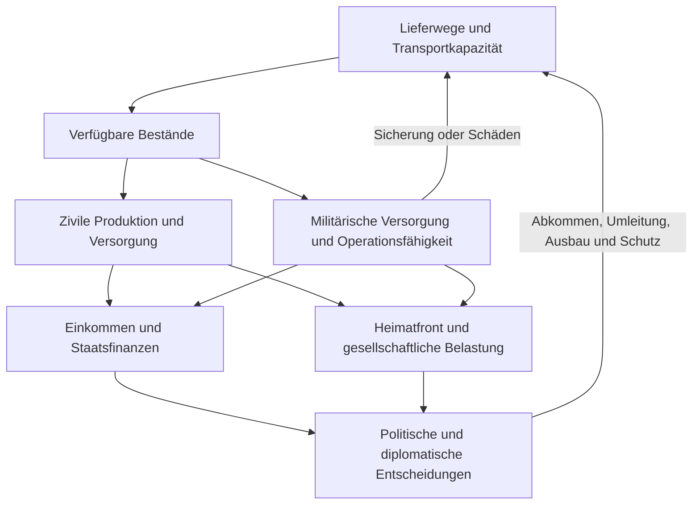

# Civilization als Vorbild für Staatsräson

**Staatsräson braucht eine Welt, in der Entscheidungen neue Fähigkeiten schaffen und Krisen diese Fähigkeiten tatsächlich beanspruchen.** Das ist die wichtigste Lehre aus Civilization VI mit Rise and Fall und Gathering Storm. In Civ werden aus einem Standort eine Stadt, aus Investitionen neue Möglichkeiten und aus diesen Möglichkeiten langfristige Abhängigkeiten. Krieg greift in diesen Aufbau ein: Er beschädigt Orte, unterbricht Erträge, verbraucht Ressourcen und belastet Beziehungen. Für Staatsräson muss dieser Zusammenhang bis zu Güterversorgung, Devisen, Staatsfinanzen, Verwaltung und Gesellschaft reichen. Der Spieler soll einen Engpass erkennen, mehrere tragfähige Wege abwägen, einen Plan durchsetzen und später sehen, was er bewirkt hat. Der vorhandene Code enthält dafür erhebliche Substanz; der nächste Entwicklungsschritt ist die durchgehende Verbindung dieser Substanz zu vollständigen Spielabläufen.

Stand dieser Untersuchung ist der **29. Oktober 2026**. Untersucht wurden dokumentierte Civ-Regeln und der vorhandene Staatsräson-Code W4, Commit `09a14ffdb767b856cfae2a900fc1d3a54bebd58b`. Die Untersuchung ist eine Quellen- und Systemanalyse; dafür wurde keine vollständige neue Civ-Partie gespielt. Die folgenden Staatsräson-Regeln sind ausdrücklich ein Entwurf. Sie sind noch nicht umgesetzt, spielgetestet oder als realwirtschaftliche Prognose kalibriert. Die Abdeckung umfasst alle für das Gesamtspiel wesentlichen Mechanikgruppen und ihre Zusammenhänge; einzelne Einheiten, Anführer, Gebäude und Bonuswerte werden nicht als vollständiges Nachschlagewerk katalogisiert.

## Civilization verändert im Verlauf die Aufgaben des Spielers

**Vor dem ersten Zug entsteht bereits ein anderes Spiel.** Zivilisation und Anführer bringen unterschiedliche Fähigkeiten mit; Karte, Schwierigkeit, Geschwindigkeit und aktive Regeln verändern verfügbare Chancen und Widerstände. Kartengröße, Ressourcen, Stadtstaaten, Siegbedingungen und Rundenlimit lassen sich ebenfalls konfigurieren. Die Geschwindigkeit skaliert unter anderem Forschungs- und Bauzeiten. Eine Marathonpartie ist damit kein bloß längeres Warten vor denselben Entscheidungen. ([Offizielles Basisspielhandbuch](https://cdn.cloudflare.steamstatic.com/steam/apps/289070/manuals/CIV_VI_25TH_ONLINE_MANUAL_ENG.pdf?t=1663263035), [Communityreferenz zu Spieleinstellungen](https://civilization.fandom.com/wiki/Starting_a_new_game_(Civ6)))

Am Anfang gründet der Spieler eine Stadt, wählt Produktion und Forschung und erkundet seine Umgebung. Der Standort entscheidet über Wasser, Nahrung, Produktion und erreichbare Ressourcen. Jeder Zug bringt Erträge und Fortschritt; Fertigstellungen erweitern anschließend die Handlungsmöglichkeiten. Der Einstieg verlangt deshalb nur einen kleinen Ausschnitt des späteren Regelwerks. Die Karte liefert laufend neue Informationen, aus denen neue Prioritäten entstehen. ([Stadtgründung](https://www.civilopedia.net/en-US/gathering-storm/concepts/cities_2/), [Standortwahl](https://www.civilopedia.net/en-US/gathering-storm/concepts/cities_3/))

Die folgende Entwicklung ist eine Analyse des Zusammenspiels der Regeln, keine vorgeschriebene Kampagne. Phasen überlappen, können durch Krieg verschoben werden und hängen von Strategie und Welt ab.

| Abschnitt einer Partie | Vorherrschende Aufgabe | Wie die Spielwelt dadurch wächst |
|---|---|---|
| Orientierung | Standort verstehen, Umfeld erkunden, erste Produktion und Sicherheit organisieren | Unbekannter Raum wird zu konkreten Chancen und Risiken |
| Expansion | Siedler, weitere Städte, Verbesserungen und Verteidigung gegeneinander abwägen | Mehr Erträge erzeugen zugleich mehr Grenzen und schützenswerte Werte |
| Spezialisierung | Städte auf Forschung, Produktion, Kultur, Religion oder Handel ausrichten | Investitionen verstärken einander; Standorte bekommen unterschiedliche Rollen |
| Regionale Verflechtung | Ressourcen, Bündnisse, konkurrierende Grenzen und Loyalität berücksichtigen | Lokaler Aufbau wird von anderen Mächten abhängig |
| Industrialisierung | Produktion, Energie, neue Rohstoffe und Verkehr ausbauen | Höhere Leistung schafft neue Versorgungs- und Umweltfragen |
| Globale Konkurrenz | Langfristige Siegketten vollenden und gegnerische Fortschritte beachten | Der Schwerpunkt verschiebt sich zu Umsetzung, Schutz und gezielter Konkurrenz |
| Abschluss | Eine überprüfbare Siegbedingung erreichen oder die Konkurrenz verlieren lassen | Die vielen Einzelentscheidungen erhalten eine gemeinsame Richtung |

**Die städtische Wirtschaft besteht aus unterschiedlichen Engpässen.** Nahrung ernährt Bevölkerung und ermöglicht bei Überschuss Wachstum; Wohnraum begrenzt dieses Wachstum zusätzlich. Bürger bearbeiten Felder oder arbeiten als Spezialisten. Eine Stadt kann daher genügend Nahrung besitzen und trotzdem an fehlendem Wohnraum hängen. Annehmlichkeiten beeinflussen Wachstum, Erträge und Unruhe. Für die Übertragung ist diese Unterscheidung entscheidend: Der Spieler muss den bindenden Engpass erkennen können. ([Nahrung und Wachstum](https://www.civilopedia.net/en-US/gathering-storm/concepts/cities_13/), [Wohnraum](https://www.civilopedia.net/en-US/gathering-storm/concepts/cities_14/), [Bürgerzuweisung](https://www.civilopedia.net/en-US/gathering-storm/concepts/cities_8/), [Annehmlichkeiten](https://www.civilopedia.net/en-US/gathering-storm/concepts/cities_16/))

Produktion bindet Zeit: Innerhalb einer Stadt konkurrieren Bauvorhaben um denselben laufenden Produktionsprozess, während andere Städte parallel bauen. Warteschlangen erleichtern die Planung; die offizielle Gathering-Storm-FAQ beschreibt auch eine gemeinsame Übersicht der städtischen Warteschlangen. Entscheidend ist der entgangene alternative Nutzen. Wer eine Einheit baut, erhält das andere gewünschte Gebäude später. ([Offizielles Handbuch, Städtebau](https://downloads.2kgames.com/civilization/vi/manuals/eu/CIV_VI_25TH_ONLINE_MANUAL_ENG.pdf), [Offizielle Gathering-Storm-FAQ](https://support.civilization.com/hc/en-us/articles/37663317924883-Civilization-VI-Gathering-Storm-FAQ))

Bezirke beanspruchen eigene Felder und erhalten Nutzen aus ihrer Umgebung. Bevölkerung begrenzt die Zahl vieler Spezialbezirke. Dadurch ist eine Forschungsstadt an einem geeigneten Standort etwas anderes als eine beliebige Stadt mit einem höheren Forschungsregler. Handwerker verändern Felder mit begrenzten Bauaktionen. Wunder verbinden einen langfristigen Bauauftrag mit räumlichen Voraussetzungen und dem Wettbewerb darum, zuerst fertig zu werden. ([Bezirke](https://www.civilopedia.net/en-US/gathering-storm/concepts/cities_10/), [Handwerker](https://www.civilopedia.net/en-US/rise-and-fall/units/unit_builder/), [Wunder](https://www.civilopedia.net/en-US/gathering-storm/concepts/cities_6/))

Gold finanziert Käufe, Aufrüstungen und laufenden Unterhalt. Handelsrouten erzeugen wiederkehrende Erträge und verbinden konkrete Städte; Händler bewegen sich nach der Wahl ihrer Route automatisch und bleiben angreifbar. Das schafft einen Zusammenhang zwischen räumlicher Sicherheit und wirtschaftlichem Nutzen. Diese Wirtschaft ist gut verständlich, bildet aber keine moderne Volkswirtschaft mit privaten Unternehmen, Bankensystem, Wechselkurs und staatlichem Budget ab. Diese Grenze ist eine Bewertung des dokumentierten Modells. ([Goldausgaben](https://www.civilopedia.net/en-US/gathering-storm/concepts/gold_3/), [Handelsrouten](https://www.civilopedia.net/en-US/gathering-storm/concepts/trade_1/), [Routenerträge](https://www.civilopedia.net/en-US/gathering-storm/concepts/trade_5/))

**Fortschritt erschließt konkrete Handlungen.** Wissenschaft führt durch den Technologiebaum zu Einheiten, Gebäuden und Fähigkeiten. Kultur treibt einen zweiten Baum aus Ausrichtungen voran, der unter anderem Regierungen und Politiken erschließt. Regierungen begrenzen die Kombination einsetzbarer Politiken. Heurekas und Inspirationen belohnen passende Aktivitäten mit Fortschritt: Der Aufbau der Welt hilft damit, die nächste Entwicklungsstufe zu erreichen. Die Forschungsschübe sind hier bewusst ohne pauschalen Prozentwert beschrieben, weil Regelstand und Sonderfähigkeiten berücksichtigt werden müssten. ([Technologien](https://www.civilopedia.net/en-US/gathering-storm/concepts/science_1/), [Technologiebaum](https://www.civilopedia.net/en-US/gathering-storm/concepts/science_4/), [Kultur](https://www.civilopedia.net/en-US/gathering-storm/concepts/culture_1/), [Regierungen](https://www.civilopedia.net/en-US/gathering-storm/concepts/govt_1/), [Heurekas](https://www.civilopedia.net/en-US/gathering-storm/concepts/science_3/), [Inspirationen](https://www.civilopedia.net/en-US/gathering-storm/concepts/culture_3/))

Große Persönlichkeiten ergänzen den Wettbewerb: Eigene Bezirke, Gebäude und Projekte erzeugen passende Punkte, über die begehrte Personen gewonnen werden. Religion besitzt eigene Glaubenssätze und Einheiten; Glauben finanziert religiöse Handlungen. Kultur und Tourismus bilden ebenfalls unterschiedliche Größen: Kultur trägt unter anderem den inneren Fortschritt, Tourismus wirkt auf die internationale kulturelle Konkurrenz. Ein hoher Wert in einer allgemeinen Kennzahl reicht daher nicht automatisch zum jeweiligen Sieg. ([Große Persönlichkeiten](https://www.civilopedia.net/en-US/gathering-storm/concepts/greatpeople_2/), [Religionsgründung](https://www.civilopedia.net/en-US/gathering-storm/concepts/faith_5/), [Religiöse Einheiten](https://www.civilopedia.net/en-US/gathering-storm/concepts/faith_6/), [Tourismus](https://www.civilopedia.net/en-US/gathering-storm/concepts/tourism_1/))

| Siegweg im vollständigen Regelrahmen | Was tatsächlich erreicht werden muss |
|---|---|
| Wissenschaft | In Gathering Storm führt die Kette über Satellit, Mondlandung und Marskolonie zur Exoplanetenexpedition; deren Ankunft entscheidet. Weitere Projekte beschleunigen die Reise. ([Raumhafen](https://www.civilopedia.net/en-US/gathering-storm/districts/district_spaceport/), [Expedition](https://www.civilopedia.net/en-US/gathering-storm/wonders/project_launch_exoplanet_expedition/)) |
| Kultur | Die eigenen auswärtigen Touristen müssen die Inlandstouristen jeder anderen Zivilisation übertreffen. ([Kultursieg](https://www.civilopedia.net/en-US/gathering-storm/concepts/victory_4/)) |
| Religion | Die eigene Religion muss in allen großen Zivilisationen vorherrschen, jeweils über die Mehrheit ihrer Städte. ([Religionssieg](https://www.civilopedia.net/en-US/gathering-storm/concepts/victory_5/)) |
| Herrschaft | Alle ursprünglichen Hauptstädte kontrollieren; dafür muss nicht jede Stadt erobert werden. ([Herrschaftssieg](https://www.civilopedia.net/en-US/gathering-storm/concepts/victory_2/)) |
| Diplomatie | Gathering Storm ergänzt Diplomatiepunkte aus internationaler Mitwirkung, Abstimmungen und weiteren Leistungen. Der Forschungsstand nennt 20 Punkte; die spätere Siegprüfung erfolgt am Zugbeginn. ([Regeltext](https://www.civilopedia.net/en-US/gathering-storm/concepts/diplomatic_victory/), [Juni-2019-Patchwiedergabe](https://civilization.fandom.com/wiki/Civilization_VI_June_2019_Update), [Mai-2020-Patchtext](https://steamdb.info/patchnotes/5054933/)) |
| Punkte | Bei der festgelegten Grenze entscheidet die höchste Wertung, sofern diese Siegbedingung aktiv ist und zuvor kein anderer Sieg erreicht wurde. ([Punktesieg](https://www.civilopedia.net/en-US/gathering-storm/concepts/victory_6/)) |

Ein besonders anschaulicher Zusammenhang liegt ganz am Ende: **Das terrestrische Laserprojekt beschleunigt die Exoplanetenexpedition nur bei bereitgestellter Energie.** Eine weit erforschte Technologie und ein abgeschlossenes Projekt genügen damit noch nicht; die gebaute Fähigkeit muss versorgt werden. Forschung, Produktion, Energie und strategisches Ziel bleiben miteinander verbunden. ([Terrestrische Laserstation](https://www.civilopedia.net/en-US/gathering-storm/wonders/project_terrestrial_laser/))

**Eine Runde ist keine feste Zahl echter Minuten.** Die üblichen Standardgrenzen lauten Online 250, Schnell 330, Standard 500, Episch 750 und Marathon 1500 Runden. Das sind konfigurierbare Grenzen, keine Zusage, dass eine Partie so lange dauert. Andere Siege können früher eintreten; Reichsgröße, Kriege, Erfahrung und Denkzeit verändern die Bearbeitung erheblich. Die Grenzwerte sind über eine Communityreferenz belegt. Eine repräsentative, nach Einstellungen bereinigte Primärmessung für eine allgemeingültige Stundenzahl wurde nicht gefunden. ([Spielgeschwindigkeit](https://civilization.fandom.com/wiki/Speed_(Civ6)))

Ein reines Rechenbeispiel verdeutlicht den Unterschied: 250 gespielte Runden mit durchschnittlich zwei Minuten eigener Bearbeitung ergeben acht Stunden und zwanzig Minuten; vier Minuten ergeben sechzehn Stunden und vierzig Minuten, jeweils ohne zusätzliche Wartezeiten. Das ist **keine gemessene typische Spieldauer**. Für Staatsräson müssen daher simulierte Zeit, bedeutsame Entscheidungen und echte Sitzungsdauer getrennt geplant werden. Fünf Amtsjahre dürfen nicht automatisch rund 1825 einzelne Tagesbestätigungen verlangen.

## Erweiterungen verbinden Aufbau mit Verwundbarkeit und Erholung

Rise and Fall ergänzt Loyalität, Gouverneure, historische Meilensteine und wechselnde Zeitalter. Städte können bei fehlender Loyalität Erträge verlieren und ausscheiden. Gouverneure lassen sich spezialisieren und versetzen. Normale, dunkle, goldene und heroische Zeitalter verändern die Bedingungen weiterer Entwicklung; ein schlechter Abschnitt lässt eine Erholungsperspektive offen. Die Erweiterung ergänzt außerdem vertiefte Allianzen und internationale Notfälle. ([Offizielles Rise-and-Fall-Handbuch](https://steamcdn-a.akamaihd.net/steam/apps/645402/manuals/CIV_VI_EXP_ONLINE_MANUAL_ENG.PDF), [Loyalität](https://www.civilopedia.net/en-US/gathering-storm/concepts/loyalty_1/))

Gathering Storm erweitert diesen Rahmen um Umweltfolgen, Strom, strategische Rohstoffvorräte, neue Ingenieurbauten, Weltkongress, Diplomatiesieg und eine Zukunftsepoche. Hier tritt stärker hervor, dass leistungsfähiger Aufbau Ressourcen beansprucht und spätere Risiken erzeugt. ([Offizielle Gathering-Storm-Ankündigung](https://ir.take2games.com/static-files/51c16200-05bd-4a81-84a6-34374bd74cae))

**Krieg findet räumlich statt.** Nahkampf, Fernkampf und Bombardierung erfüllen unterschiedliche Aufgaben. Gelände, Flüsse, Flankierung, Unterstützung und Kontrollzonen beeinflussen die Bedeutung eines Ortes. Befestigte Städte benötigen passende Angriffe und Zeit; Belagerung und beschädigte Mauern verändern Verteidigung und Reparaturbedarf. Spätere Korps und Armeen beziehungsweise Flotten und Armadas verdichten militärische Stärke. See- und Luftstreitkräfte besitzen eigene Bewegungs-, Basis- und Verteidigungsentscheidungen. ([Kampfwerte](https://www.civilopedia.net/en-US/gathering-storm/concepts/combat_5/), [Gelände und Kampfboni](https://www.civilopedia.net/en-US/gathering-storm/concepts/combat_7/), [Kontrollzonen](https://www.civilopedia.net/en-US/gathering-storm/concepts/movement_3/), [Stadtkampf](https://www.civilopedia.net/en-US/gathering-storm/concepts/combat_9/), [Formationen](https://www.civilopedia.net/en-US/gathering-storm/concepts/combat_12/), [Luftpatrouillen](https://www.civilopedia.net/en-US/rise-and-fall/concepts/aircombat_3/))

Bewegung hängt dabei von Fähigkeiten ab: Kontrollzonen beeinflussen den Weg bestimmter Einheiten, frühe Schiffe sind räumlich eingeschränkt, weitere Technik öffnet den Ozean. Formationen erlauben gemeinsame Bewegung passender Kampf- und Unterstützungs- oder Zivileinheiten. Der Spieler kann Kräfte damit nicht beliebig als austauschbare Punkte über die Karte verschieben. ([Seebewegung](https://www.civilopedia.net/en-US/gathering-storm/concepts/movement_4/), [Kontrollzonen](https://www.civilopedia.net/en-US/gathering-storm/concepts/movement_3/), [Formationen](https://www.civilopedia.net/en-US/gathering-storm/concepts/combat_12/))

Ein Angriff verändert zugleich die Wirtschaft. Plünderung setzt Verbesserungen und Bezirksgebäude außer Betrieb; Reparaturen beanspruchen anschließend Bauaktionen oder Produktion. Handelswege können verloren gehen. Unterhalt und Rohstoffbedarf begrenzen Streitkräfte; in Gathering Storm werden strategische Ressourcen gewonnen, gelagert und für Herstellung beziehungsweise laufenden Betrieb eingesetzt. Manche dieser Rohstoffe versorgen auch Kraftwerke. Kriegsmüdigkeit belastet Annehmlichkeiten und damit städtische Entwicklung. ([Plünderung](https://www.civilopedia.net/en-US/gathering-storm/concepts/combat_13/), [Handelswege, Communityreferenz](https://civilization.fandom.com/wiki/Trade_Route_%28Civ6%29), [Verbrauchbare Ressourcen](https://www.civilopedia.net/en-US/gathering-storm/concepts/consumeable_resources/), [Kriegsmüdigkeit](https://www.civilopedia.net/en-US/gathering-storm/concepts/combat_3/))

Eroberung verlangt weitere Entscheidungen über Behalten oder Befreien und, soweit zulässig, Zerstören einer Stadt. Frieden kann ausgehandelt werden, ohne den Gegner vollständig zu beseitigen. Nukleare Eskalation hinterlässt Schäden und Fallout und kann internationale Reaktionen auslösen. Diese Regeln führen zum wichtigen Gestaltungsprinzip: **Militärischer Erfolg verändert die Aufgaben nach dem Kampf.** ([Eroberung](https://www.civilopedia.net/en-US/gathering-storm/concepts/combat_10/), [Kriegsende](https://www.civilopedia.net/en-US/gathering-storm/concepts/combat_4/), [Nukleare Schäden](https://www.civilopedia.net/en-US/gathering-storm/concepts/nukes_2/))

Diplomatie ergänzt die räumliche Welt um Interessen und Wissen. Anführer besitzen erkennbare und zunächst verborgene Agenden; diplomatische Sichtbarkeit eröffnet zusätzliche Informationen. Delegationen, Botschaften, Handel und Spionage haben deshalb auch einen Informationswert. Spionage braucht Zeit und kann scheitern. Stadtstaaten schaffen einen umkämpften Einflussraum: Gesandte und Suzeränstatus ermöglichen besondere Vorteile, die ein Konkurrent streitig machen kann. ([Agenden](https://www.civilopedia.net/en-US/gathering-storm/concepts/diplo_13/), [Diplomatische Sichtbarkeit](https://www.civilopedia.net/en-US/gathering-storm/concepts/diplo_4/), [Spionage](https://www.civilopedia.net/en-US/gathering-storm/concepts/diplo_5/), [Suzeränstatus](https://www.civilopedia.net/en-US/gathering-storm/concepts/citystates_5/))

Allianzen können auf Forschung, Kultur, Militär, Religion oder Wirtschaft ausgerichtet werden und durch Zusammenarbeit weitere Stufen erreichen. Gathering Storm bewertet Aggression und gebrochene Zusagen über Beschwerden zwischen Mächten. Kriegsgründe beeinflussen diese Bewertung. Der Weltkongress verbindet zeitweilige Regeln, Wettbewerbe und Sondersitzungen mit diplomatischer Gunst. Internationale Notfälle geben Beteiligten ein gemeinsames Ziel und eine Frist; die Entwickler beschrieben sie ausdrücklich auch als Gegenmittel gegen bereits entschiedene, stagnierende Partien. ([Allianzen](https://www.civilopedia.net/en-US/gathering-storm/concepts/alliances_1/), [Beschwerden](https://www.civilopedia.net/en-US/gathering-storm/concepts/grievances/), [Weltkongress](https://www.civilopedia.net/en-US/gathering-storm/concepts/world_congress/), [Offizielle Beschreibung der Notfälle](https://steamcommunity.com/games/289070/announcements/detail/1465222576769486958))

**Umweltkrisen haben Orte, Vorbedingungen und Gegenmaßnahmen.** Überflutungen, Dürren, Vulkane und Stürme verändern die Karte. Manche Katastrophen steigern später die Fruchtbarkeit; dies gilt nicht pauschal für jeden Ereignistyp. Dämme und andere Ingenieurbauten verändern Gefährdung und Nutzung. Spätere Energieversorgung verbessert Gebäudeleistung, während der Einsatz fossiler Rohstoffe den Klimapfad belastet. Meeresspiegelanstieg kann Küsten zunächst überfluten und später dauerhaft versenken. Wartung älterer Atomkraftwerke ist ein weiterer vorbeugender Bauauftrag. ([Gathering Storm bei Aspyr](https://www.aspyr.com/games/sid-meier-s-civilization-vi-gathering-storm), [Umweltwirkungen](https://www.civilopedia.net/en-US/gathering-storm/concepts/environmental_effects/), [Energie](https://www.civilopedia.net/en-US/gathering-storm/concepts/power/), [Offizielles GS-Handbuch](https://cdn.2kgames.com/manuals/civilization-vi/gathering_storm/2KGMKT_CIV6_Gathering_Storm_PC_Online_Manual_V7_US.pdf))

Zusatzmodi sind davon zu trennen. Apokalypse, Geheimgesellschaften, Dramatische Zeitalter, Helden, Monopole/Korporationen und Zombies gehören zu separat aktivierbaren New-Frontier-Inhalten. Technologie-/Ausrichtungszufall und Barbarenclans kamen als kostenlose Ergänzungen. Leader Pass ergänzt Anführer. Das Black-Death-Szenario ist keine allgemeine Seuchenmechanik der normalen Hauptpartie. Waldbrände und Meteorschauer wurden später auch außerhalb des Apokalypse-Modus ergänzt; Kometen und Sonnenstürme gehören zu dessen Sonderregeln. ([Aspyr-Inhaltsübersicht](https://support.aspyr.com/hc/en-us/articles/4407200939661-What-s-in-the-New-Frontier-Pass-Civilization-VI), [Produktübersicht](https://store.steampowered.com/app/289070/Sid_Meiers_Civilization_VI/), [Mai-2020-Patch](https://steamdb.info/patchnotes/5054933/), [GS-Szenarien](https://www.aspyr.com/games/sid-meier-s-civilization-vi-gathering-storm))

Aus diesen Regeln folgt eine starke, aber begrenzte Vorlage. Civ verbindet viele Entscheidungen zuverlässig mit Orten und dauerhaften Investitionen. Seine Ressourcenlager sind jedoch noch kein modernes regionales Nachschubnetz vom Werk über Hafen und Straße bis zum Verband. Auch Kredit-, Devisen- und Branchenkrisen muss Staatsräson eigenständig modellieren. Der im Rise-and-Fall-Handbuch beschriebene Versorgungskonvoi unterstützt Heilung und Bewegung; daraus lässt sich keine vollständige Lieferkettenwirtschaft ableiten. ([Rise-and-Fall-Handbuch](https://steamcdn-a.akamaihd.net/steam/apps/645402/manuals/CIV_VI_EXP_ONLINE_MANUAL_ENG.PDF))

Die Vorlage bringt außerdem Risiken mit: Mehr Städte und Einheiten können mehr repetitive Arbeit erzeugen. Früher Vorsprung kann sich über Erträge und Forschung verstärken. Viele exakte Teilregeln können wichtiger werden als die verständliche strategische Entscheidung. Das sind Designrisiken aus der Systemstruktur, keine in dieser Untersuchung gemessenen Urteile über jede Partie. Staatsräson sollte deshalb Routine delegierbar machen, Expansion mit echten Folgekosten verbinden und mehrere glaubwürdige Erfolgspfade erhalten. Gute Vorbereitung muss eine spätere Krise tatsächlich abschwächen dürfen.

## Staatsräson braucht eine gemeinsame Wirtschaft für Alltag und Krieg

**Das vorgeschlagene Spielerlebnis lautet: Lage verstehen, Ziel wählen, Plan durchsetzen, Umsetzung verfolgen und Folgen bewerten.** Der Spieler übernimmt einen bestehenden modernen Staat. Fortschritt bedeutet deshalb Modernisierung, bessere Versorgung, neue industrielle Fähigkeiten und verlässlichere Institutionen. Er muss keine grundlegende Staatlichkeit wie eine antike Technologie freischalten. Eine Forschung eröffnet eine Möglichkeit; Ausbildung, Lizenzen, Bau, Anschluss und Betrieb machen sie nutzbar.

Die zentrale Übertragung ist eine dauerhafte, sichtbare Wirkungskette. Ein Kraftwerk versorgt eine bisher eingeschränkte Industrieregion. Die Betriebe können dadurch mehr produzieren; Einkommen und Steuereinnahmen verändern sich. Gleichzeitig benötigt das Kraftwerk Personal, Wartung und gegebenenfalls Brennstoff. Ein späterer Ausfall trifft die tatsächlich abhängigen Betriebe. Der Spieler versteht sowohl den Nutzen seiner Investition als auch ihre Verwundbarkeit.

Die folgende **eigene Designgrafik** zeigt die vorgeschlagenen Abhängigkeiten für Staatsräson. Sie beschreibt weder die vollständige Civ-Simulation noch bereits durchgehend vorhandenes Spielverhalten.

| Civ-Prinzip | Entwurf für Staatsräson | Neue Entscheidung des Spielers |
|---|---|---|
| Unterschiedliche Wachstumsengpässe | Kaufkraft, Wohnraum, Arbeit, Versorgung und Dienste getrennt betrachten | Den bindenden Engpass behandeln |
| Ortsabhängige Bezirke | Hafen, Bahn, Strom, Qualifikation und Lieferanten bestimmen Standortgüte | Den passenden Ausbau am passenden Ort wählen |
| Begrenzte Produktion | Bau-, Personal-, Verwaltungs- und Transportkapazität | Geld und tatsächliche Umsetzbarkeit gemeinsam planen |
| Unterhalt nach Fertigstellung | Betrieb, Wartung, Ersatzteile und Finanzierung | Eine dauerhaft tragbare Investition wählen |
| Fortschritt durch passende Aktivitäten | Pilotanlage, Praxiserfahrung, Lizenzierung und breite Einführung | Lernen mit realen Vorhaben verbinden |
| Sichtbare Handelsrouten | Mengen, Kapazität, Laufzeit und Ausfallrisiko | Abhängigkeiten diversifizieren oder absichern |
| Langfristige Ziele | Mehrjährige nationale Vorhaben und politisches Vermächtnis | Zwischen konkurrierenden Zukunftsbildern entscheiden |
| Kartenlinsen | Versorgung, Handel, Projekte, Stimmung und Kriegsschäden | Dieselbe Welt nach einer konkreten Frage lesen |

Ein moderner Präsident steuert private Unternehmen nicht wie einzelne Civ-Bürger. Öffentliche Beschaffung, Steuerpolitik, Regulierung, Finanzierung und private Investitionen benötigen unterschiedliche Wege. Ebenso können Gesetzesänderungen nicht als beliebiger Politik-Kartentausch erfolgen. Mehrheit, Zuständigkeit, Gerichte, Kommunen und Vertragspartner bestimmen, was beschlossen und tatsächlich umgesetzt wird. Politisches Kapital ist dabei weder Geld noch Material.

**Der vorhandene Code ist umfangreicher als ein bloßer Prototyp einzelner Menüs.** Er enthält bereits Tagesfortschritt, Monatswirtschaft, Güter, Streitkräfte, Infrastruktur, Kriegsfolgen und Wiederaufbau. Entscheidend ist, diese Zustände durchgängig zusammenzuführen. Die folgende Gegenüberstellung beruht auf erneutem Codeabgleich, nicht auf einer Annahme, alles müsse neu gebaut werden.

| Bereich | Im W4-Stand vorhanden | Konkrete Lücke für den Entwurf |
|---|---|---|
| Zeit und Welt | Tagesmärkte, Monatsrechnung und viele Fachmodule | Anzeigen und Abrechnungen brauchen einen eindeutig gemeinsamen Bezugsstand. [Zeitkern](</Users/yusufyeneroglu/Desktop/Staatsraeson/game/src/sim/world.ts:105>), [Monatskette](</Users/yusufyeneroglu/Desktop/Staatsraeson/game/src/sim/spiel.ts:324>) |
| Güter | Produktion, Bedarf, Importe, Export, Lager und Störungen | Normalversorgung füllt Lager in der Güterfunktion ohne eigene Transport- und Importbuchung auf. [Gütermonat](</Users/yusufyeneroglu/Desktop/Staatsraeson/game/src/sim/gueter.ts:204>) |
| Außenwirtschaft | Leistungsbilanztreiber, Kapitalströme und Reserven | Die Rechnung ist keine Summe tatsächlich abgewickelter Einzelimporte; Dollar-BIP hängt am Szenario-BIP und laufenden Wechselkurs. [Devisen](</Users/yusufyeneroglu/Desktop/Staatsraeson/game/src/sim/devisen.ts:135>) |
| Beschaffung | Einkauf, Produktion, Modernisierung, Lieferstopps und Etatkapazität | Gespeicherte Kosten werden im Beschaffungsmonat nicht als eigene Zahlung gebucht; bestehende Etatdeckung muss ausdrücklich zugeordnet werden. [Beschaffung](</Users/yusufyeneroglu/Desktop/Staatsraeson/game/src/sim/streitkraefte.ts:336>), [Monatsschritt](</Users/yusufyeneroglu/Desktop/Staatsraeson/game/src/sim/streitkraefte.ts:403>) |
| Krieg | Eskalation, Front, Verluste, Munition, Waffenruhe, Frieden und Besatzung | Regionenkontrolle folgt weitgehend einem globalen Frontwert, noch keinem Netz selbstständiger Formationen und Lieferwege. [Regionenkontrolle](</Users/yusufyeneroglu/Desktop/Staatsraeson/game/src/sim/kriegsschauplatz.ts:356>) |
| Kriegsfolgen | Kriegsmüdigkeit, Zustimmung, Tourismus, Kapitalabzug, Risikoaufschläge und Sanktionen | Diese Folgen stärker aus tatsächlichen Schäden, Verpflichtungen und Ausfällen ableiten. [Kriegspreis](</Users/yusufyeneroglu/Desktop/Staatsraeson/game/src/sim/kriegspreis.ts:95>) |
| Infrastruktur und Katastrophen | Kapazität, Zustand, Ausbau, unsichere Schäden, Hilfe und Wiederaufbau | Reale Lieferwege und dauerhafte räumliche Schäden mit diesen Kapazitäten verbinden. [Infrastruktur](</Users/yusufyeneroglu/Desktop/Staatsraeson/game/src/sim/infrastruktur.ts:341>), [Katastrophen](</Users/yusufyeneroglu/Desktop/Staatsraeson/game/src/sim/katastrophe.ts:36>) |
| Gesetze | Neuer Weg mit Fassungen und zusätzlichen Folgen | Alte Zugänge können den erforderlichen Vorhabenkontext umgehen. [Gesetzesfolgen](</Users/yusufyeneroglu/Desktop/Staatsraeson/game/src/sim/gesetzgebung.ts:417>) |
| Kartenfortschritt | Baustellenlinien wachsen mit laufenden Projekten | Fertige Strecken fallen aus diesem Darstellungspfad; statische Megaprojekte werden andernorts ohne Bestandsprüfung gezeichnet. [Baulinien](</Users/yusufyeneroglu/Desktop/Staatsraeson/game/src/ui/atlas/neubau.ts:25>), [Megaprojekte](</Users/yusufyeneroglu/Desktop/Staatsraeson/game/src/ui/atlas/vector.ts:1062>) |

**Die vorgeschlagene Mindestwirtschaft benötigt getrennte Bestände, Flüsse und Kapazitäten.** Güter haben Vorrat, Produktion, tatsächliche Lieferungen, Verbrauch und Verluste. Transportwege haben Kapazität, Transitrecht und Reisezeit. Betriebe benötigen Personal, Wartung, Energie und Vorprodukte. Der Staat verfügt über Einnahmen, bewilligte Mittel, Zahlungen, Schulden und Zinsen. Außenfinanzierung umfasst zusätzlich Fremdwährungsbedarf und Kapitalströme. Einkommen und Versorgung werden nach betroffenen Regionen und Gruppen ausgewertet. Elektrischer Strom ist dabei kein beliebig lagerbarer Brennstoff: Erzeugung, Netzleistung und ausdrücklich modellierte Speicher bleiben getrennt.

Eine zentrale Identität lautet: **Endbestand = Anfangsbestand + eingetroffene Produktion und Importe − gelieferter Verbrauch und Exporte − Verluste.** Eine Bestellung erzeugt noch keinen Vorrat. Ungedeckter Bedarf bleibt sichtbar. Ein Indexbonus darf fehlende Ware nicht stillschweigend ersetzen. Ebenso darf eine Ausgabe nur einmal verbucht werden. Beschaffung kann einen vorhandenen Verteidigungsetat beanspruchen; zusätzliche Belastung entsteht erst, wenn dessen Deckung überschritten oder andere Verpflichtungen verdrängt werden. Einfach sämtliche angezeigten Beschaffungskosten zusätzlich abzuziehen würde eine neue Doppelbelastung riskieren.

Auch die Außenrechnung braucht eine erkennbare Brücke: Warenimporte beanspruchen Devisen, Exporte bringen Erlöse; private Finanzierung und andere Kapitalströme verändern das Ergebnis. Ein Handelsdefizit darf deshalb nicht automatisch eins zu eins als Reserveverlust erscheinen. Für den Anfang genügen wenige entscheidungsrelevante Branchen und Gütergruppen. Eine zusätzliche Güterklasse lohnt sich, wenn sie andere Engpässe oder Gegenmaßnahmen eröffnet.

Die Abrechnung sollte eine feste Reihenfolge besitzen: Bestände sichern, Aufträge und Kapazitäten verteilen, Produktion und Transport abwickeln, Verbrauch erfüllen, Zahlungen abrechnen und anschließend Preis-, Beschäftigungs- und gesellschaftliche Folgen ableiten. Tagesereignisse dürfen sofort wirken; ein späterer Monatsabschluss darf dieselbe Zahlung oder Lieferung nicht erneut erzeugen. Ein gemeinsames Journal von Mengen, Kosten und Ursachen erleichtert Vorschau, Erklärung und Fehlersuche. Dafür muss nicht jede bestehende Weltmutation sofort auf vollständiges Event-Sourcing umgeschrieben werden.

**Krieg beansprucht genau diese Wirtschaft.** Sein Ausgangspunkt ist ein politisches Ziel: ein Gebiet halten, einen Rückzug erreichen oder einen Korridor sichern. Verfügbare Formationen besitzen Standort, Personal, Material, Bereitschaft, Munition, Treibstoff und Auftrag. Der Spieler entscheidet auf einer überschaubaren operativen Ebene über Verteidigung, Verlegung, begrenzten Angriff oder Rückzug. Reisezeit und Nachschub begrenzen die Durchführung. Luft- und Seeaufträge verändern Aufklärung, Schutz und Erreichbarkeit; sie müssen mit denselben Regionen und Transportwegen verbunden sein.

Mobilisierung erhöht militärische Möglichkeiten und bindet zugleich Arbeitskräfte und Geld. Munition und Treibstoff stehen nur einmal zur Verfügung. Ein beschädigter Hafen verringert die dort tatsächlich abgewickelte Importkapazität; ein vorhandener Ersatzhafen kann den Schaden begrenzen. Daraus folgen betroffene Produktionsausfälle, Einkommensverluste und Belastungen des Haushalts. Ein beliebiger Auslandskrieg darf nicht automatisch alle Branchen gleich treffen. Umfang, Ort, Beteiligte und Abhängigkeit bestimmen die Wirkung.

Handelsfolgen sollten im Entwurf nach Partner, Ware und Route unterschieden werden. Ein neutraler Lieferant kann weiter liefern, während ein anderer ein Embargo befolgt oder höhere Gegenleistungen verlangt. Eine gefährdete Seeroute kann durch höhere Transport- und Versicherungskosten teurer werden, ohne vollständig auszufallen. Ein beschädigter Anschluss begrenzt dagegen die physische Menge. Der Spieler muss sehen, ob ihm Ware, Kapazität, Vertragspartner oder Finanzierung fehlt, weil jede Ursache andere Gegenmaßnahmen verlangt.

Der Gegner braucht Ziele, Reserven, Bündnisse, Informationen und eine Abwägung von Kosten. Hohe Spannung kann Drohung, Abschreckung, begrenzte Aktion oder Krieg bedeuten. Im derzeitigen Tageszweig folgt ein Angriff einer Eskalationsschwelle ohne vorgelagerte Kräfte- und Zielabwägung; für Waffenruhe fehlt dort ein regelmäßiger eigener Verhandlungsschritt. Das sind konkrete Ansatzpunkte. ([Kriegszustände](</Users/yusufyeneroglu/Desktop/Staatsraeson/game/src/sim/krieg.ts:1073>))

Verträge sollten Partner, Leistung, Menge, Laufzeit, Zahlung, Voraussetzung und Erfüllungsstand enthalten. Sanktionen betreffen bestimmte Güter, Teilnehmer und Durchsetzungswege. Glaubwürdigkeit entsteht aus eingehaltenen Verpflichtungen. Militärischer Fortschritt verändert Verhandlungsmöglichkeiten, garantiert aber keine beliebigen Forderungen. Waffenruhe benötigt überprüfbare Bedingungen, Verstoßfolgen und einen Weg zum Frieden. Danach bleiben Demobilisierung, Versorgung von Veteranen, Reparaturen, Besatzungskosten und Neuordnung des Handels echte Aufgaben.

## Drei Krisen zeigen, was der Spieler wirklich tun soll

**Lösbarkeit bedeutet, den Verlauf durch verständliche Handlungen verändern zu können.** Sie umfasst Schadenbegrenzung, Teilerfolg, Kompromiss und Wiederaufbau. Sie garantiert keinen verlustfreien Sieg aus jeder Ausgangslage. Jede Krise braucht eine Ursache, betroffene Orte, verfügbare Puffer, Eingriffe mit Vorlauf und einen überprüfbaren Abschlusszustand. Ereignisfenster berichten darüber und öffnen passende Handlungen. Die folgenden Fälle sind erfundene Entwürfe für Spieltests.

**Ein begrenzter Grenzkrieg bedroht einen Handels- und Nachschubkorridor.** Vorzeichen können Truppenbewegungen, ein gekündigtes Transitabkommen oder höhere Frachtkosten sein. Geheimdienstmeldungen zeigen Bandbreiten; eigene Reservebestände bleiben nachvollziehbar. Vor dem Ausbruch kann der Spieler vermitteln, Garantien anbieten, defensive Bereitschaft erhöhen oder eine alternative Route sichern. Eine sichtbare Mobilisierung verbessert Bereitschaft, kann aber das Eskalationsrisiko und laufende Kosten steigern.

Fällt der Korridor aus, konkurrieren zivile Güter und militärischer Nachschub um die verbleibenden Wege. Die Karte zeigt, welche Regionen und Betriebe betroffen sind. Der Spieler verfügt über mehrere Strategien mit unterschiedlichen Ergebnissen:

| Strategie | Was sie erreichen kann | Was sie kostet oder riskiert |
|---|---|---|
| Front halten und vermitteln | Kräfte erhalten, Operationstempo begrenzen, verhandelbaren Zustand schaffen | Begrenzte Gebietsverluste, innenpolitischer Druck, längere Unsicherheit |
| Korridor durch begrenzte Operation wieder öffnen | Versorgung und Bewegungsfreiheit verbessern | Höherer Materialverbrauch, Verluste, mögliche Sanktionen, verdrängte zivile Vorhaben |
| Auf haltbare Linie zurückgehen | Streitkräfte und Bevölkerung sichern, Versorgung vereinfachen | Zugeständnisse, Evakuierungskosten, Vertrauensverlust bei Teilen des eigenen Lagers |

Eine militärisch erfolgreiche Operation kann die Finanzlage verschärfen. Eine sparsame Haltung kann strategisch riskanter sein. Erfolg besteht darin, das begrenzte Ziel oder einen tragfähigen Ausstieg zu erreichen, während Nachschub und zivile Mindestversorgung aufrechterhalten werden. Scheitert der ursprüngliche Plan, bleiben Tempo reduzieren, Ziel ändern und verhandeln mögliche Reaktionen. Nach Kriegsende verschwinden Schulden und Schäden nicht. Wiederaufbau und politische Aufarbeitung prägen die folgenden Monate.

**Eine Energieimportkrise wird zugleich zur Devisen- und Verteilungskrise.** Ein einfaches Modellbeispiel macht den Zusammenhang prüfbar: Monatsbedarf 100 Einheiten, heimisches Angebot 40, reguläre Einfuhr 60. Fallen 30 Einheiten Einfuhr aus und enthält der Vorrat 60, bleiben rechnerisch zwei Monate Puffer. Eine Ersatzlieferung von 15 und eine Bedarfsreduktion von 10 verringern die Lücke auf fünf; unter unveränderten Bedingungen reicht derselbe Vorrat zwölf Monate. Diese Zahlen sind fiktive Rechenwerte. Die Vorschau muss ihre Annahmen und Liefertermine offenlegen.

Reservefreigabe hilft sofort, verbraucht aber einen endlichen Puffer. Ersatzimporte verringern die Lücke nach Ankunft und benötigen Devisen sowie freie Hafen- oder Pipelinekapazität. Lastpriorisierung schützt Kliniken, Haushalte oder kritische Betriebe, belastet jedoch andere Verbraucher. Gezielte Einkommenshilfe mindert soziale Härten, erzeugt aber keine zusätzliche Energie. Eine Preisbegrenzung kann den sichtbaren Preis verändern, während Finanzierung oder physische Fehlmenge ungelöst bleiben. Effizienz und neue Erzeugung wirken später und konkurrieren um Baukapazität und Komponenten.

Die Krise gilt im Entwurf erst als stabilisiert, wenn essenzielle Nachfrage über mehrere Abrechnungen gedeckt ist und die verbleibende Lösung ohne dauerhaften Abbau der Notreserve finanzierbar bleibt. Wer Versorgung mit hohen Schulden sichert, hat einen Fortschritt erzielt und eine Finanzierungsaufgabe hinterlassen. Das Spiel muss beides zeigen. Der nächste Schritt kann Reserveaufbau, bessere Effizienz, andere Lieferanten oder zusätzliche heimische Produktion sein.

**So könnte eine 45-Minuten-Sitzung dieser Krise aussehen.** Die Zeitangaben sind zu testende Ziele für Bedienung und Dramaturgie, keine gemessene Dauer. Pausieren und schneller Zeitvorlauf bleiben verfügbar.

| Sitzungsabschnitt | Konkrete Spielerhandlung | Sichtbare Rückmeldung |
|---|---|---|
| Minute 0–5 | Warnung öffnen, betroffene Route und Industrieorte anklicken, Reserveprognose prüfen | Fehlende Menge, unsichere Meldungen und bestätigte Lieferungen sind getrennt |
| Minute 5–12 | Versorgung priorisieren, Reservefreigabe und Ausgleich finanzieren | Sofortkosten, verdrängte Verbraucher und erste Wirkungsfrist werden angezeigt |
| Minute 12–20 | Angebote zweier Lieferanten vergleichen und verhandeln | Preis, Devisenbedarf, Ankunft, Kapazität und politische Bedingungen unterscheiden sich |
| Minute 20–27 | Zeit vorlaufen lassen; bei einem Kapazitätsproblem anhalten und umplanen | Eine echte Abweichung unterbricht den Ablauf; die Vorratsprognose verändert sich |
| Minute 27–35 | Eingetroffene Ladung mit Vertrag vergleichen, harte Einschränkungen anpassen | Versorgung verbessert sich; höhere Importkosten bleiben sichtbar |
| Minute 35–45 | Monatsbilanz prüfen, langfristiges Vorhaben beginnen, Routineüberwachung delegieren | Ein Teilergebnis ist erreicht, ein neues Ziel und seine Verpflichtungen stehen fest |

Die Sitzung endet mit einer veränderten Welt. Sofortmaßnahmen können stabilisiert haben; der langfristige Ausbau bleibt eine Baustelle. Bei schlechter Ausgangslage kann ein teurer Kompromiss das Ergebnis sein. Entscheidend ist, dass der Spieler seinen eigenen Beitrag und die verbleibende Aufgabe versteht.

**Ein Erdbeben erzeugt eine lange Wiederaufbau- und Vertrauenskrise.** Ein exakter Ereignistermin darf nicht künstlich vorhergesagt werden. Vorher erkennbar sind Risikogebiete, verletzliche Gebäude und Bereitschaft. Nach dem Ereignis verbessert sich das zunächst unsichere Lagebild durch Erkundung und Zugang. Das bestehende Katastrophenmodell enthält bereits unsichere Schäden, Hilfsphasen und Wiederaufbauprojekte. ([Katastrophenmodell](</Users/yusufyeneroglu/Desktop/Staatsraeson/game/src/sim/katastrophe.ts:36>))

In den ersten Tagen werden erreichbare Rettungs-, Krankenhaus-, Transport- und Unterkunftskapazitäten priorisiert. In den folgenden Wochen stehen Grundversorgung, sichere Gebäude und belastbare Zusagen im Mittelpunkt. Über Monate konkurriert Wiederaufbau mit anderen Vorhaben um Material, Fachkräfte und Verwaltung. Über Jahre zählen tatsächlich nutzbare Wohnungen, Schulen, Leitungen und Arbeitsplätze. Eine erfolgreiche Bauvergabe allein darf noch keine zurückgekehrten Einwohner erzeugen.

Staatliche Koordination, kommunale und private Beteiligung oder internationale Hilfe können unterschiedliche tragfähige Wege bilden. Dabei bleiben Bedingungen, Verteilung und Kontrolle relevant. Beschleunigung in einer Region kann andernorts Projekte verzögern. Übertriebene Versprechen verschieben den politischen Preis in die Zukunft. Erfolg heißt zunächst Mindestversorgung sichern und anschließend dauerhafte Kapazitätsverluste abbauen. Eine beruhigte Nachrichtenlage oder ein höherer Zustimmungswert beweist keinen abgeschlossenen Wiederaufbau.

Für alle drei Fälle gelten gemeinsame Fairnessregeln. Wo Vorwarnung sachlich möglich ist, muss sie vor der entscheidenden Verschärfung sichtbar sein. Überraschende Ereignisse dürfen bekannte Risiken treffen. Verzögerungen und Puffer schaffen Zeit zum Handeln. Normale Testlagen sollten mindestens zwei verständliche, tragfähige Wege bieten; vorherige schwere Fehler dürfen den Handlungsspielraum einschränken. Gute Vorbereitung verbessert denselben Krisenfall messbar. Schwierigkeit entsteht aus knapperen Mitteln und kompetenteren Gegnern, während die eigenen Konten zuverlässig bleiben.

## Oberfläche und Ausbau müssen denselben Zusammenhang beweisen

**Die Hauptoberfläche sollte vier Fragen sofort beantworten: Was braucht meine Entscheidung, was kann ich tun, was kostet es und wann zeigt sich die Wirkung?** Die Karte bleibt der räumliche Mittelpunkt. Ein ausgewählter Ort öffnet seine Lage, Verbindungen und Aufträge. Eine ausgewählte Maßnahme hebt die betroffenen Orte, Wege und konkurrierenden Aufgaben hervor. Kartenlinsen in Civ zeigen, wie dieselbe Welt nach unterschiedlichen Fragestellungen lesbar wird; einige erscheinen passend zur aktiven Handlung. ([Civ-Kartenlinsen](https://www.civilopedia.net/en-US/gathering-storm/concepts/world_7/))

Für Staatsräson ergibt sich folgende Ordnung als Entwurf. Die Lageansicht zeigt wenige wichtige Änderungen seit der letzten Kontrolle, ihre Ursache und die nächste Frist. Die Karte zeigt Versorgung, Handel, Projekte, politische Stimmung oder Operationen als wechselnde Perspektiven. Ein gemeinsamer Bereich für Pläne bündelt Gesetze, Bau, Beschaffung und diplomatische Pakete, während die Zuständigkeiten sichtbar bleiben. Akteure nennen Interessen und Bedingungen. Ein Verlauf erklärt, welche Lieferungen, Beschlüsse oder Verzögerungen eine Kennzahl verändert haben. Detailwissen bleibt aufklappbar.

Jeder Auftrag braucht vor dem Beschluss eine verständliche Vorschau: Zweck, Voraussetzungen, sofortige und laufende Kosten, erste Wirkung, wichtigste Unsicherheit, verdrängte Aufgabe und Ausstiegskosten. Später wird diese Vorschau mit dem tatsächlichen Verlauf verglichen. Unsichere Gegnerinformationen dürfen als Schätzung erscheinen; eigene Buchungen müssen nachvollziehbar sein. Historische Statistik erhält einen erkennbaren Veröffentlichungsstand. Aktuelle Karten und Dossiers dürfen nicht versehentlich verschiedene Gegenwarten zeigen.

Ein Werk besitzt sichtbare Zustände: geplant, finanziert, im Bau, betriebsbereit, beschädigt, im Wiederaufbau oder stillgelegt. Fertige Anlagen müssen auf der Karte bleiben und ihre Funktion erfüllen. Schäden bleiben sichtbar, bis sie tatsächlich behoben sind. Die Türkei kann auf vorhandener Provinzebene detailliert bleiben; Außenstaaten benötigen vor allem ihre relevanten Fähigkeiten, Interessen, Verbindungen und Konfliktregionen. Eine gleich tiefe Simulation jedes Landes ist für die Spielentscheidung nicht erforderlich.

**Langfristiger Fortschritt muss die Art der Entscheidungen verändern.** Eine beispielhafte Kette beginnt mit Reservefreigabe und Ersatzimporten, setzt sich mit Effizienz und Netzausbau fort und führt nach Ausbildung, Bau und Lizenzierung zu zusätzlicher Produktion. In der nächsten Krise ist das Land weniger abhängig. Gleichzeitig entstehen neue Aufgaben: Auslastung, Exportverträge, Fachkräfte, Wartung und regionale Verteilung. Vier Horizonte bleiben sichtbar: heutiger Auftrag, nächste Ankunft oder Fertigstellung, neue Fähigkeit und langfristiges politisches Ziel.

| Kampagnenabschnitt als Entwurf | Schwerpunkt | Was erhalten bleibt |
|---|---|---|
| Amtsantritt | Erbe verstehen, Kabinett und Mehrheit organisieren, Prioritäten wählen | Verträge, Schulden, Institutionen und vorhandene Infrastruktur |
| Frühe Amtszeit | Engpässe überbrücken, Reformen durchsetzen, neue Kapazität beginnen | Baustellen, ausgebildetes Personal, politische Verpflichtungen |
| Mittlere Amtszeit | Eigene Strategie bewährt sich oder erzeugt neue Abhängigkeiten | Neue Werke, veränderte Branchen und Bündnisse |
| Letztes Amtsjahr | Versprechen, Krisenfolgen, Wahl und Bilanz zusammenbringen | Sichtbare Leistungen und weiterhin offene Kosten |
| Weitere Amtszeit oder Nachfolge | Größere Möglichkeiten mit geerbten Folgewirkungen | Dieselbe Welt ohne kostenlose Rücksetzung |

Diese Schwerpunkte sind keine erzwungene Ereignisfolge. Eine friedliche Modernisierung, eine diplomatische Laufbahn oder ein innenpolitischer Schwerpunkt müssen vollständige Partien tragen. Erfolgsziele können dauerhaft tragbare Finanzen, überwundene Versorgungskrisen, produktive Fähigkeiten, belastbare Institutionen oder ein stabiler Frieden sein. Wahlerfolg ist ein eigenes politisches Ergebnis und beweist nicht automatisch die Qualität aller anderen Bereiche. Amtszeiten, Zielwahl und Endzustände existieren bereits im Projekt; eine beliebige Fortsetzung nach Amtsverlust wäre eine zusätzliche Produktentscheidung. ([Amtszeitbeginn](</Users/yusufyeneroglu/Desktop/Staatsraeson/game/src/sim/amtszeit.ts:169>), [Zielwahl](</Users/yusufyeneroglu/Desktop/Staatsraeson/game/src/sim/amtszeit.ts:210>), [Endzustände](</Users/yusufyeneroglu/Desktop/Staatsraeson/game/src/sim/enden.ts:454>))

Die reale Kampagnenlänge muss ein Spieltest bestimmen. Gemessen werden sollten Zeit bis zur ersten selbst verursachten sichtbaren Veränderung, sinnvolle Entscheidungen pro Sitzung, Warte- und Bestätigungsanteil, Krisendauer und Abbruchstellen. Ruhige Monate dürfen schnell vergehen. Ministermandate und feste Budgets können Routine übernehmen; echte Abweichungen holen den Spieler zurück. Krieg darf anspruchsvoll sein und trotzdem pausierbar bleiben.

Lange Bauzeiten bleiben durch Zwischenziele spielbar: Genehmigung und Finanzierung, freier Anschluss, Pilotbetrieb und abschnittsweise Inbetriebnahme können jeweils Entscheidungen und sichtbare Fortschritte liefern. Ein fertiggestellter Teil darf nur den tatsächlich verfügbaren Nutzen erzeugen. Planung, Delegation und begründeter Zeitvorlauf überbrücken Routine; eine mehrjährige Strecke wird für eine schnelle Belohnung nicht plötzlich fertig. Während sie wächst, entwickelt sich der übrige Staat weiter.

**Der erste Ausbau sollte eine vollständige Versorgungskrise vom Ausfall bis zur Erholung liefern.** Dazu gehören sofort benutzbare Oberfläche, gemeinsame Konten und glaubwürdige Entscheidungen. Danach wird derselbe Zusammenhang durch einen begrenzten Krieg beansprucht. Die Reihenfolge ist ein Vorschlag nach technischen Abhängigkeiten, keine belastbare Aufwandsschätzung.

| Ausbauetappe | Konkreter Liefergegenstand | Nachweis, dass sie funktioniert |
|---|---|---|
| Gemeinsame Befehle und Buchungen | Einheitliche Prüfung, Kostenbesitzer, Etatdeckung, Bestände und Lieferungen | Fehlgeschlagene Handlung kostet nichts; erfolgreiche Handlung bucht genau einmal; keine Ware ohne Herkunft; Laden erhält den Zustand |
| Zivile Versorgungskrise | Ein kritischer Energieträger, mehrere Quellen, Reserve, Transportgrenze, Finanzierung und Gegenmaßnahmen | Ausfall leert Vorräte; Umleitung hilft erst nach Ankunft; mindestens zwei Strategien bewältigen eine normale Testlage mit verschiedenen Kosten |
| Begrenzter Krieg | Wenige Regionen und Formationen, Aufträge, Nachschub, Ziele, Handelsfolgen und verhandelbares Ende | Fehlender Nachschub begrenzt Operationen; zivile Schäden folgen realen Engpässen; Waffenruhe hat überprüfbare nächste Schritte; Nachkriegskosten bleiben |
| Durchgängige Hauptoberfläche | Lage, Karte, Plan, Vorschau und Verlauf für dieselbe Kette | Spieler findet Ursache, Option, Kosten und Frist ohne Suchlauf; fertige und zerstörte Werke erscheinen korrekt |
| Mehrjährige Entwicklung | Wissen, Investition, Institutionen und Wahlen tragen Folgen weiter | Vorsorge verbessert spätere Krisen; verschiedene politische Wege bleiben spielbar; Nichtstun ist nicht stets überlegen |
| Ausbau und Balance | Weitere Güter, Regionen und Krisen benutzen die geprüfte Grundlage | Neue Inhalte erzeugen keine eigenen widersprüchlichen Konten oder zweiten Aktionswege |

Ein früher konkreter Fehlerfall betrifft Kriegskarten: Ereignisoptionen deklarieren Kosten und rufen anschließend eine erneut preisprüfende Fachhandlung auf. Beide brauchen einen gemeinsamen Kostenbesitzer. Ein weiterer betrifft den Gesetzeszugang: Minister, direkte UI und Texteingabe müssen dieselbe institutionelle Prüfung auslösen. Diese Reparaturen sind Voraussetzungen für verlässliche Spielentscheidungen. ([Kriegskarten](</Users/yusufyeneroglu/Desktop/Staatsraeson/game/src/sim/ereignisse-krieg.ts:52>), [Kriegsaktion](</Users/yusufyeneroglu/Desktop/Staatsraeson/game/src/sim/krieg.ts:503>), [Gesetzgebungsweg](</Users/yusufyeneroglu/Desktop/Staatsraeson/game/src/sim/gesetzgebung.ts:331>))

Abgenommen werden muss der gesamte Ablauf über normale Spielerhandlungen. Derselbe Hafenverlust muss Kartenstatus, Liefermenge, Produktion und Finanzbedarf konsistent verändern. Ein nutzbarer Ersatzhafen muss den Schaden begrenzen. Ein Vertrag ohne freie Transportkapazität darf keine sofortige Lieferung erzeugen. Ein Friedensschluss muss Gefechte beenden und Nachwirkungen erhalten. Gespeicherter Zustand und Zufall müssen reproduzierbare Vergleiche ermöglichen. Ergänzend braucht es beobachtete Spieltests: Eine große Zahl grüner Unit-Tests beweist weder Orientierung noch langfristige Spannung.

Die wichtigste offene Produktentscheidung ist damit der gewünschte Umfang dieser ersten vollständig verbundenen Spielwelt. Dafür ist zunächst kein Totalneubau nötig. Ein kleinerer Ausschnitt, in dem Versorgung, Krieg, Diplomatie und Gesellschaft überprüfbar zusammenwirken, schafft eine tragfähige Grundlage für die spätere Breite. Der endgültige Qualitätsnachweis ist erreicht, wenn der Spieler eine Krise aus eigener Diagnose bewältigen kann und Jahre später noch die Folgen seiner damaligen Entscheidungen erkennt.

**Quellen- und Gültigkeitsgrenzen.** Offizielle Handbücher, Publisher- und Supportseiten wurden mit konkreten Spielhilfetexten und gekennzeichneten Communityreferenzen kombiniert. `civilopedia.net` ist ein inoffizieller Spiegel; selbst ein Gathering-Storm-Pfad garantiert keinen aktualisierten Text. Der allgemeine Wissenschaftssiegtext nennt dort noch den Mars, während die konkreten GS-Projekte die Exoplanetenexpedition belegen. Beim Diplomatiesieg hat der spätere Patch Vorrang vor einem alten „sofort“-Text. Exakte aktuelle Kampfwerte, sämtliche Bonuszahlen und jede Platzierungsregel wurden nicht vollständig geprüft. Keine allgemeine Stundenlänge, keine kompetente KI und kein fertiges Staatsräson-Spiel werden durch diese Analyse behauptet. Die konkreten Designzahlen, Gleichgewichte und Bedienungsziele müssen in der Umsetzung und in Spieltests überprüft werden.
